## 面向对象的基本概念

面向对象编程（Object-Oriented Programming，OOP）是一种编程范式，它基于“对象”的概念，将数据和操作数据的方法封装在一起。面向对象的四大基本特征是抽象、封装、继承和多态，这些特征构成了 OOP 的核心。

1. **抽象**（Abstraction）： 抽象是指隐藏对象的内部细节，只暴露必要的接口。这允许我们忽略那些不影响我们工作的细节，专注于对象的外部行为。在编程中，抽象可以通过接口或抽象类来实现。
2. **封装**（Encapsulation）： 封装是将数据（属性）和操作这些数据的方法（行为）捆绑在一起，并隐藏内部实现细节。这有助于减少系统部分间的依赖，提高代码的可维护性和可重用性。在类中，通常通过访问修饰符（如 private、public）来实现封装。
3. **继承**（Inheritance）： 继承是一种创建新类的方式，新类继承现有类的属性和方法，并能添加或修改某些属性和方法。继承支持代码重用，并能建立类之间的层次结构。
4. **多态**（Polymorphism）： 多态是指允许不同类的对象对同一消息做出响应的能力，即同一个接口可以被不同的实例以不同的方式实现。这使得代码更加灵活，可以写出更通用的代码。

在进行面向对象编程之前，通常需要经过以下阶段：

- **面向对象分析**（Object-Oriented Analysis，OOA）： 在这个阶段，分析者会研究业务需求，识别系统中的对象以及这些对象之间的关系。目的是理解问题域，并定义系统的结构和行为。
- **面向对象设计**（Object-Oriented Design，OOD）： 设计阶段是在分析阶段之后进行的，它涉及将分析阶段得到的需求转化为一个详细的设计。这包括确定类的结构、职责、接口以及类之间的交互方式。
- **面向对象编程**（Object-Oriented Programming，OOP）： 这是实际编码的阶段，开发者根据分析和设计阶段的成果，使用 OOP 语言（如 Java、C++、Python 等）实现具体的类和方法。

## 为什么要面向对象设计（OOD）

面向对象设计（OOD）是一种以对象为核心的软件设计方法论，它专注于将数据和行为封装成对象，并通过类和继承等概念来建立对象之间的关系。OOD 的目的是创建一种易于管理、维护、扩展和复用的软件架构。由于软件需求总是不断变化，OOD 提供了一种灵活的设计方法来适应这些变化，它能够将变化的影响局限在特定的对象或类中，从而避免了对整个系统架构的大规模改动。

OOD 通过提供清晰的模块化结构，使得开发过程更加高效，也使得团队成员能够更容易地理解和协作。每个对象负责自己的数据和行为，这样的封装减少了系统各部分之间的依赖，提高了代码的复用性。此外，OOD 支持通过继承和多态来创建可扩展的系统，使得添加新功能时，可以简单地通过添加新的类或修改现有类来实现，而不必重写大量代码。

良好的 OOD 能够降低软件缺陷率，因为它允许每个模块独立测试和调试。它还提供了一种共同的语言和概念框架，促进了团队成员之间的沟通。OOD 是一种能够以最小的代价满足变化需求的设计方法，它使得软件系统可以轻松扩展，同时保持了代码的清晰结构和高质量。

统一建模语言（UML）是一种用于软件工程的图形化语言，它为面向对象的设计和开发提供了一套标准的符号和图示。UML 由对象管理组织（OMG）在 1997 年推出，旨在帮助软件开发者以一种统一和标准化的方式进行系统建模。

## UML 语言

Unifed Modeling Language， 又称统一建模语言或标准建模语言，是始于 1997 年一个 OMG(Object Management Group)标准，它是一个模型化和软件系统开发的图形化语言。

UML 的主要目标是促进团队协作，通过提供一种共同的语言来描述、构建和文档化软件系统。它包括了一系列的图示，每种图示都用于展示系统的不同方面，以下是 UML 中常见的 10 种图：

1. **类图**（Class Diagram）： 展示了系统中的类、接口、它们的属性、操作以及它们之间的关系。
2. **对象图**（Object Diagram）： 是类图的实例，展示了特定时刻系统中对象的实例以及它们之间的关系。
3. **用例图**（Use Case Diagram）： 描述系统的功能和用户如何与这些功能交互。
4. **组件图**（Component Diagram）： 描述系统的物理结构，包括软件组件和它们之间的关系。
5. **部署图**（Deployment Diagram）： 描述系统的硬件结构以及软件组件如何在硬件上分布。
6. **组合结构图**（Composite Structure Diagram）：用来显示组合结构或部分系统的内部构造。
7. **序列图**（Sequence Diagram）： 显示对象之间如何交互以及它们交互的顺序。
8. **协作图**（Collaboration Diagram）： 与序列图类似，但更侧重于对象之间的关系。
9. **状态图**（State Diagram）： 描述对象的状态以及状态之间的转换。
10. **活动图**（Activity Diagram）： 展示了业务流程或系统内部工作流程。

UML 为软件开发的每个阶段提供了支持，从需求收集、系统架构设计、详细设计到系统实施。它不仅帮助开发者理解系统，还帮助项目管理者、系统分析师和测试人员更好地理解系统的功能和结构。通过使用 UML，团队成员可以更有效地沟通，确保对系统有共同的理解，从而提高开发效率和质量。此外，UML 图也可以作为项目文档的一部分，为未来的维护和升级提供参考。


## 类与类之间的关系

### 继承（泛化）

继承关系（Inheritance）和泛化关系（Generalization）是类之间一种非常重要的连接方式。这种关系描述了基类（父类或超类）和派生类（子类或子类型）之间的 A is B 关系。这意味着派生类不仅继承了基类的属性和方法，而且在语义上是基类的一种特殊类型。

如果有一个基类名为“员工”，而“经理”、“软件开发工程师”和“销售”都是“员工”的特定类型，那么这些派生类都“是”一个“员工”。这种关系可以用 UML 类图来表示，其中派生类会用一个空心的三角形箭头指向基类，表明派生类是从基类泛化或继承而来。

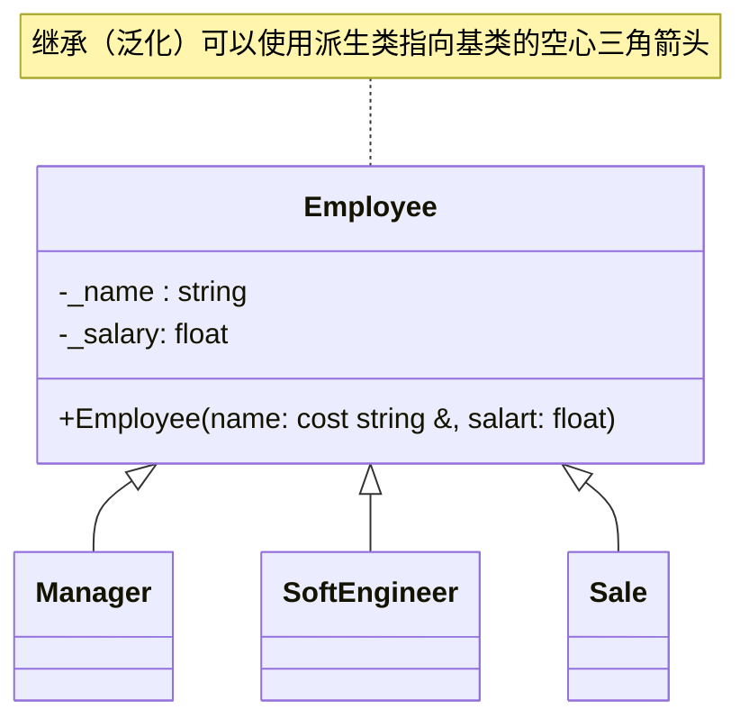

这里的箭头指向基类，表明派生类继承了基类的属性和方法。

**继承与泛化的区别**：
继承是一种自底向上的思考方式。我们先定义一个基类，然后根据需要从这个基类派生出新的子类。子类继承了基类的特性，并可以添加自己独有的特性或覆盖基类的行为。继承支持代码复用，并允许运行时多态。

泛化是一种自顶向下的思考方式。我们先识别出不同事物的共同点，然后定义一个抽象的基类，再从这个基类派生出具体的子类。泛化更多地关注概念上的分类，而不是具体的实现细节。

### 关联

关联关系是面向对象编程中表达类与类之间关系的一种方式，它描述了两个类在概念上或逻辑上的联系。这种关系体现了对象间的交互和通信，是面向对象设计中的基本组成部分。

关联关系在语义上体现为“A has B”的关系，意味着一个对象包含或拥有另一个对象。这种关系是相对稳定的，通常反映了现实世界中的某种固定联系。

关联关系可以是双向的也可以是单向的，但无论哪种形式，关联关系中的两个类互不负责对方的生命周期管理。

**双向关联关系** 意味着两个类互相知道对方的存在，它们之间可以互相访问。例如，在一个电商系统中，客户与订单之间通常存在双向关联关系，因为客户可以查看自己的订单，同时订单也可以追溯到下订单的客户。

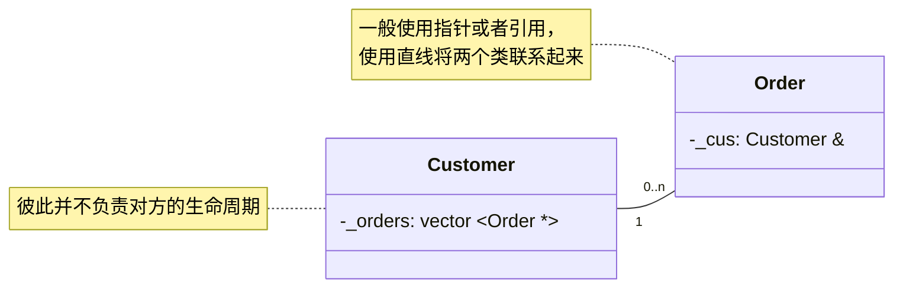

**单向关联关系** 则表示一个类知道另一个类的存在，但另一个类不必然知道这个类的存在。例如，在多线程编程中，条件变量（Condition）可能需要知道互斥锁（MutexLock）的存在，以便在等待条件满足时锁定和解锁互斥锁，但互斥锁本身可能并不知道条件变量的存在。

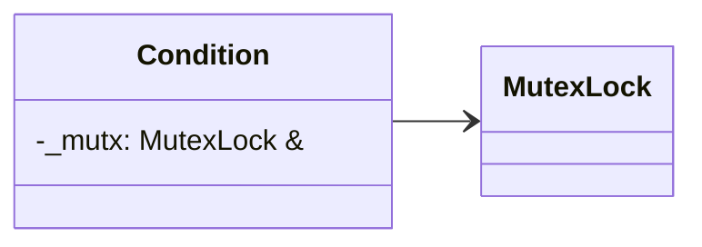

在 UML 类图中，关联关系使用以下方式表示：

- 双向关联关系通常用一条普通的实线表示，如果需要标识关系，可以给这条线加上标签。
- 单向关联关系用一条带有箭头的实线表示，箭头指向被关联的对象。

在代码层面，关联关系通常通过指针或引用来实现。在一个类中，可以通过声明另一个类的指针或引用成员变量来表达这种关系。这种实现方式使得一个对象可以访问另一个对象的属性和方法，从而实现对象间的交互。

### 聚合

聚合关系是关联关系的一种，它表达了类之间的整体与部分的关系，这种关系比一般关联关系更强，但比组合关系弱。

在聚合关系中，整体对象可以没有部分对象而独立存在，部分对象也可以被看作是整体对象的一部分。重要的是，整体对象不负责部分对象的生命周期管理，也就是说，部分对象可以独立于整体对象被创建和销毁。

聚合关系在语义上表现为“A has B”的关系，意味着 A 对象包含 B 对象作为其一部分。这种关系在设计时需要仔细考虑，因为它涉及到对象的组织和生命周期管理。

在 UML 类图中，聚合关系用一条带空心菱形的实线表示，菱形指向整体类。如果需要标识关系，可以给这条线加上标签。

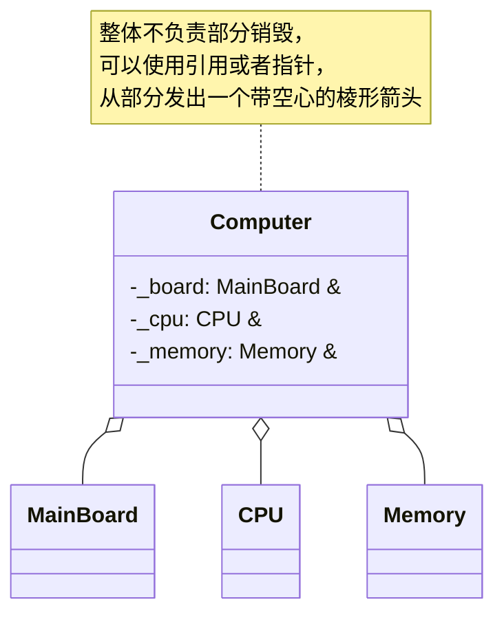

在代码中，聚合关系通常通过包含指向部分对象的引用或指针的数据成员来实现。

### 组合

组合关系是面向对象设计中一种非常强的关联关系，它表达了类之间的整体与部分的关系，这种关系比聚合更强。在组合关系中，整体对象的生命周期控制着部分对象的生命周期。也就是说，当整体对象被销毁时，其拥有的部分对象也会被自动销毁。这种关系体现了整体与部分之间的紧密联系，部分对象不能独立于整体对象存在。

在语义上，组合关系表现为“A contains B”或“A is composed of B”，意味着 A 对象由 B 对象组成，B 对象是 A 对象不可分割的一部分。

在 UML 类图中，组合关系用一条带实心菱形的实线表示，菱形指向整体类。

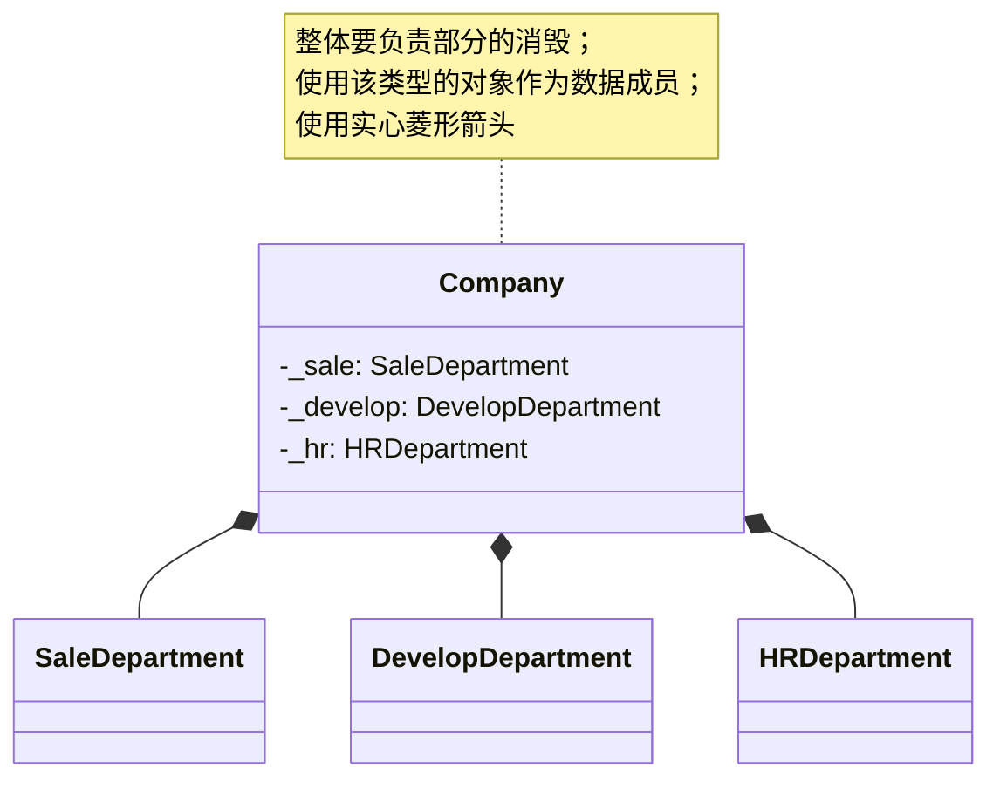


在代码中，组合关系通常通过将部分对象作为整体类的一个数据成员来实现，这个数据成员可以是一个对象而不是指针或引用。

组合关系的正确使用可以帮助我们设计出更合理、更符合现实世界情况的软件系统。它强调了整体与部分之间的强依赖关系，并且简化了资源管理，因为整体对象会自动管理其组成部分的生命周期。

### 依赖

依赖关系（Dependency）是类之间最弱的一种关系，它描述了一种使用关系，其中一个类的变化可能会影响到另一个类。这种关系是临时的、不稳定的，并且通常不会导致类之间有长期的联系。依赖关系通常发生在方法级别，而不是类级别，它反映了类之间的交互或者一个类对另一个类的依赖。

在语义上，依赖关系表现为“A uses B”的关系，意味着类 A 在某种程度上使用了类 B。这种使用可以是以下几种形式：

1. 类 B 的对象作为类 A 的一个成员函数的参数。
2. 类 B 的对象作为类 A 的成员函数内部的局部变量。
3. 类 A 的成员函数返回一个类 B 的对象或引用。
4. 类 A 的成员函数调用了类 B 的静态方法。

在 UML 类图中，依赖关系用一条带有箭头的虚线表示，箭头从使用类（A）指向被依赖的类（B）。

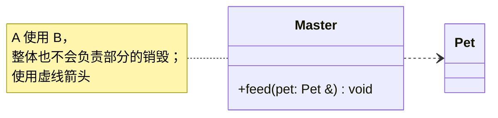


在代码中，依赖关系可能表现为以下几种情况：

```cpp
class Master {
 public:
  void feed(Pet pet) {}
};

class Pet {
 public:
};
```

在这个例子中，类 A 依赖于类 B，因为类 A 的成员函数 `function` 使用了类 B 的对象。

依赖关系是一种非常常见的关系，它允许类之间进行灵活的交互，而不需要建立长期的联系。这种关系的使用可以提高系统的灵活性和可维护性，但也需要注意不要滥用，以免导致系统过于松散和难以理解。

### 五种关系的总结

1. **依赖关系**（Dependency）：
   - 耦合度最低，表示一个类在其方法中使用了另一个类，但并不持有另一个类的引用或实例。
   - 语义上是“A uses B”。
   - 在 UML 中用带箭头的虚线表示，箭头从使用类指向被依赖的类。
2. **关联关系**（Association）：
   - 耦合度高于依赖，表示两个类之间有较强的关系，一个类的对象可能持有另一个类的对象的引用或实例。
   - 语义上是“A has B”。
   - 在 UML 中用实线表示，如果有方向性，则使用带箭头的实线。
3. **聚合关系**（Aggregation）：
   - 耦合度高于关联，表示整体与部分的关系，但整体不负责部分的生命周期。
   - 语义上是“A has B”，且部分可以离开整体独立存在。
   - 在 UML 中用带空心菱形的实线表示，菱形指向整体。
4. **组合关系**（Composition）：
   - 耦合度高于聚合，也是表示整体与部分的关系，但整体负责部分的生命周期。
   - 语义上是“A has B”，部分对象不能离开整体对象独立存在。
   - 在 UML 中用带实心菱形的实线表示，菱形指向整体。
5. **继承关系**（Inheritance）：
   - 耦合度最高，表示一个类（子类）继承另一个类（父类）的属性和方法，是一种特殊的关系。
   - 语义上是“A is B”。
   - 在 UML 中用带空心三角箭头的实线表示，箭头从子类指向父类。

从方向性来看，继承通常被视为垂直关系，因为它表达了类之间的层次结构；而依赖、关联、聚合和组合则被视为水平关系，因为它们表达了类之间的同伴或同事关系。

在实现多态时，继承和虚函数是常用的机制，因为它们允许子类覆盖父类的行为。然而，组合和依赖关系提供了另一种实现多态的方式，这种方式基于对象的组合，允许更灵活的代码重用和更低的耦合度。通过组合不同的对象来构建系统，可以在不修改现有代码的情况下，通过替换对象来改变系统的行为。这种基于对象的多态性提供了一种更细粒度的控制和更大的灵活性。

## 面向对象的设计原则

在进行面向对象设计的时候，需要考虑类与类之间的关系，这样可以让类之间的关系更加明确。但是，除此之外，在进行面向对象设计的时候，还需要注意满足一定的设计要求，也就是面向对象的设计原则，只有遵循一定的原则，才能更好的满足软件的设计需求，更好的满足变化。而一个优良的系统设计，强调要保持低耦合、高内聚的要求，为了满足这个要求，面向对象的设计原则设计了七种。

### 单一职责原则

单一职责原则（Single Responsibility Principle, SRP）是面向对象设计中的一个基本原则，它主张一个类应当只有一个引起它变化的原因。这个原则的核心在于提升类的内聚性并减少耦合度，意味着类应该全神贯注于一项职责，并且该职责被完全封装在类中。

在实践中，这意味着如果一个类承担了多项职责，那么它很可能会在多个不同的方向上发生变化，这不仅会降低类的可维护性，也会增加类之间的依赖性。因此，应该将不同的职责分配给不同的类，使得每个类只关注于一项任务。

应用单一职责原则可以提高类的可复用性，因为职责单一的类更容易在不同的上下文中被使用。同时，它也使得类的维护变得更加容易，因为修改一个职责不会影响到其他职责。为了有效地实施这一原则，设计人员需要有能力识别出类的不同职责，并将它们分离到不同的类中。这通常涉及到定义清晰的类接口，并避免职责扩散，即避免在已经具有多重职责的类中添加新的功能。

确定类的职责以及如何恰当地分离这些职责需要设计人员具备较强的分析和设计技能。此外，设计人员还需要在类的职责单一性和系统整体复杂性之间找到平衡点，以确保类的大小和数量保持在合理的范围内。

例子：将长方形类的画图与计算面积功能分开，这样的话，计算面积就是计算面积，画图就是画图。

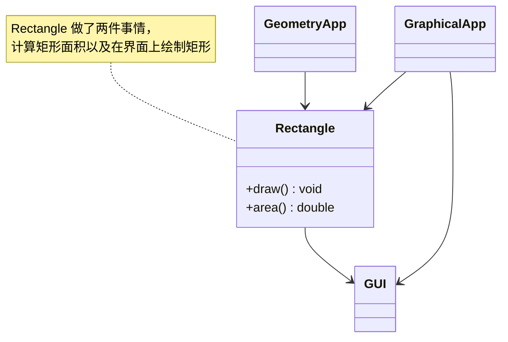

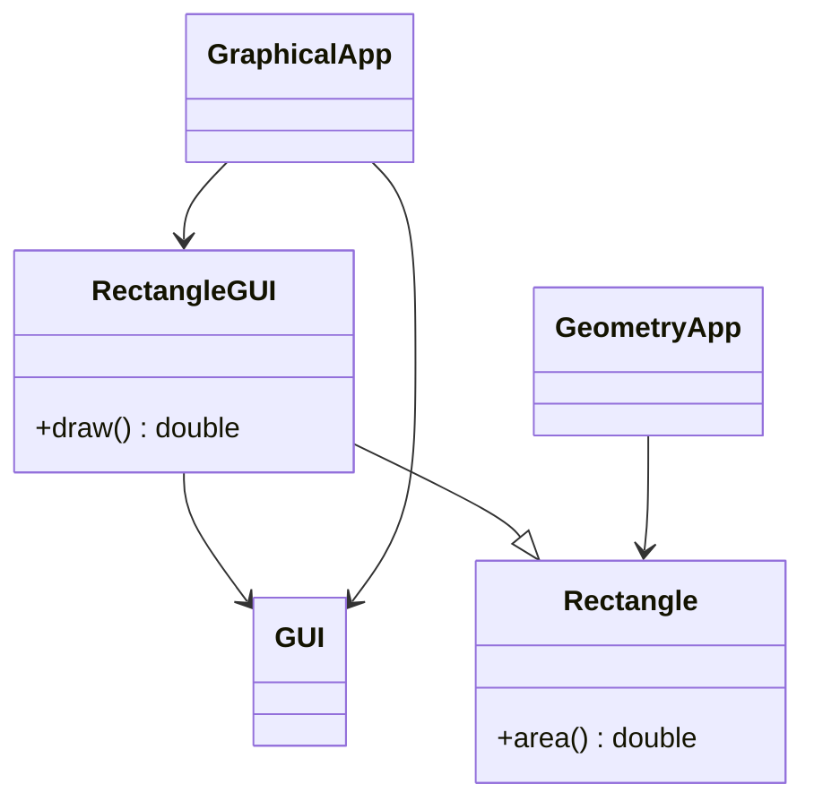

### 开闭原则

开闭原则（Open-Closed Principle, OCP）是面向对象设计中的核心原则之一，它指出软件实体应该对扩展开放，对修改关闭。这意味着当软件系统需要增加新功能或适应新需求时，应该能够通过添加新的代码来实现，而不是修改现有的代码。开闭原则是提高软件可复用性和可维护性的关键，它强调在设计时考虑未来可能的变化，从而使得系统更加灵活和可扩展。

开闭原则的核心在于对抽象编程，而不是对具体实现编程。抽象是相对稳定的，而具体实现则可能经常变化。因此，通过定义稳定的抽象层，并将可能变化的具体实现细节放在独立的模块中，可以确保系统的稳定性和可扩展性。

在实际应用中，开闭原则要求设计师在系统设计初期就考虑可能的变化，并为这些变化提供抽象的接口或抽象类。这样，当需要改变系统行为时，只需添加新的具体实现类来扩展现有的抽象层，而无需修改原有的抽象层代码。这种方法不仅减少了对现有代码的依赖，也降低了引入新功能时可能引起的错误。

例如，在 C++ 中，可以通过定义抽象类来创建一个稳定的抽象层，然后通过继承这些抽象类来实现具体的行为。如果需要修改或扩展系统的功能，可以简单地增加新的派生类，而无需改动原有的抽象类或其他派生类。这样，系统就可以在不修改现有代码的基础上进行扩展，从而满足开闭原则的要求。

随着软件系统的规模不断扩大和寿命不断延长，软件维护成本也越来越高。因此，设计满足开闭原则的软件系统变得越来越重要。通过遵循开闭原则，可以提高系统的适应性和灵活性，同时保持系统的稳定性和可维护性。这对于构建长期运行和持续发展的软件系统至关重要。

例子：版本升级，不改源代码，原来的功能就是可以使用的。计算器代码的实现：分别设计加减乘除，不如直接使用继承，实现虚方法。

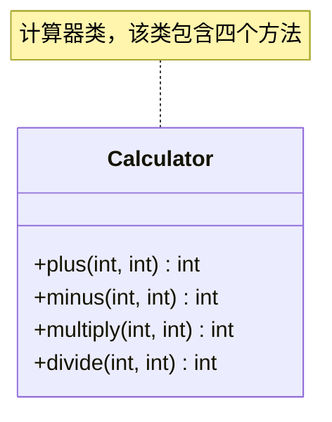

```cpp
class Calculator {
 public:
  int plus(int x, int y) {
    return x + y;
  }
  int minus(int x, int y) {
    return x - y;
  }
  int multiply(int x, int y) {
    return x * y;
  }
  int divide(int x, int y) {
    if(0 != y) {
      return x / y;
    }
    else {
      cout << "除数不能为0" << endl;
      return 1 << 31;
    }
  }
};
```

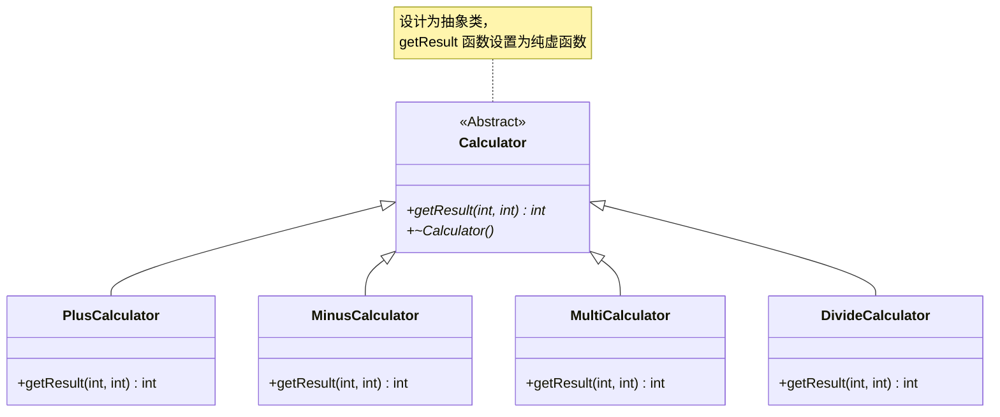

```cpp
class Calculator {
 public:
  virtual int getResult(int x, int y) = 0;
  virtual ~Calculator() {}
};

class PlusCalculator : public Calculator {
 public:
  virtual int getResult(int x, int y) {
    return x + y;
  }
  ~PlusCalculator() {
  }
};

class MinusCalculator : public Calculator {
 public:
  virtual int getResult(int x, int y) {
    return x - y;
  }
  ~MinusCalculator() {
  }
};

class MultiplyCalculator : public Calculator {
 public:
  virtual int getResult(int x, int y) {
    return x * y;
  }
  ~MultiplyCalculator() {
  }
};

class DivideCalculator : public Calculator {
 public:
  virtual int getResult(int x, int y) {
    if (0 != y) {
      return x / y;
    } else {
      cout << "除数不能为0" << endl;
      return 1 << 31;
    }
  }
  ~DivideCalculator() {
  }
};
```

### 里氏替换原则

里氏代换原则（Liskov Substitution Principle, LSP）是由芭芭拉·里斯科夫提出的面向对象设计原则，它是继承复用的基础。这一原则的核心观点是，派生类（子类）对象应该能够无缝替换所有基类（父类）对象，而不影响程序的正确性。换句话说，如果一个类继承自另一个类，那么它的实例应该能够在任何地方替换基类的实例，不会引起程序出错或异常。

里氏代换原则强调的是派生类必须能够兼容基类。这意味着派生类可以增加新的行为，但不应该改变基类已有的行为。派生类可以实现基类的抽象方法来表现多态，但不应该覆盖基类的非抽象方法，因为这样做可能会破坏基类的行为。例如，如果有一个基类 `Animal` 和它的派生类 `Dog`，我们可以认为喜欢 `Animal` 的人也一定喜欢 `Dog`，因为 `Dog` 是 `Animal` 的一种。但是，如果某人喜欢 `Dog`，我们不能断定这个人也喜欢所有类型的 `Animal`。

这一原则是实现开闭原则的重要手段之一。在程序中，我们应当尽量使用基类类型来定义对象，而在运行时再确定其具体的派生类类型。这样做可以在不修改现有代码的基础上，通过引入新的派生类来扩展系统的功能。

在实际应用中，应当将基类设计为抽象类或接口，让派生类继承基类或实现接口，并实现基类中声明的方法。在运行时，派生类的实例可以替换基类的实例，从而方便地扩展系统的功能，无需修改原有派生类的代码。增加新功能可以通过增加新的派生类来实现。

里氏代换原则有助于提高代码的可维护性和可扩展性，它要求我们在设计类层次结构时，仔细考虑派生类与基类之间的关系，确保派生类能够兼容基类。这样，当系统需要变化时，我们可以安全地引入新的派生类，而不必担心会对现有的系统造成破坏。

有代码的实现：（注意接口的概念，功能服务，普通函数、自由函数，类的 public 成员函数，虚函数， 纯虚函数），注意与隐藏做区分，派生类要保有原来的功能，然后在此基础上扩展该功能。

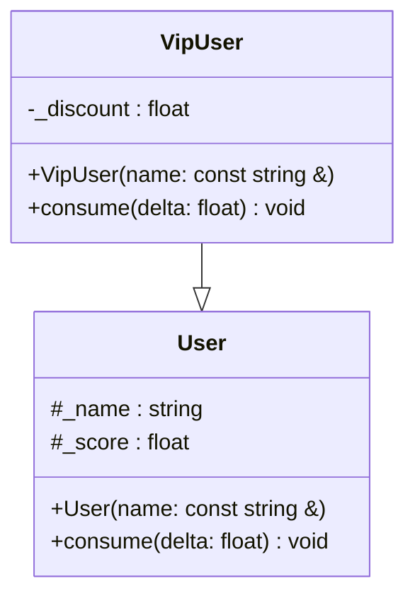

```cpp
class User {
 public:
  User(const string &name) : _name(name), _score(0) {
  }

  void consume(float delta) {
    cout << "User::consume()" << endl;
    _score += delta;
    cout << ">> " << _name << " consume " << delta << endl;
  }

 protected:
  string _name;
  float _score;
};

class VipUser : public User {
 public:
  VipUser(const string &name) : User(name), _discount(1) {
  }

  void consume(float delta) {
    cout << "VipUser::consume(float)" << endl;
    float tmp = delta * _discount;
    _score += tmp;
    if (_score > 1000) {
      _discount = 0.9;
    }
    cout << ">> " << _name << " consume " << tmp << endl;
  }

 private:
  float _discount;
};

void test() {
  User user("刘德华");
  user.consume(2000);
  user.consume(2000);
  cout << endl;
  VipUser vip("张学友");
  vip.consume(2000);
  vip.consume(2000);//改变了基类的方法，隐藏
}

```

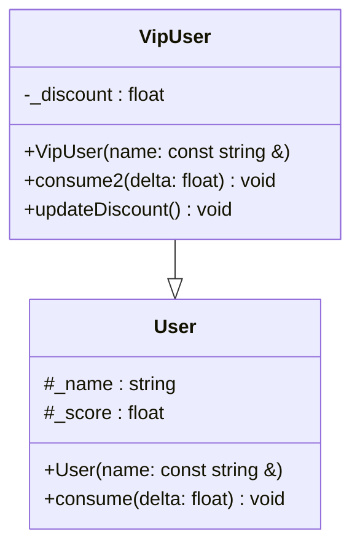

```cpp
class User {
 public:
  User(const string &name) : _name(name), _score(0) {
  }

  void consume(float delta) {
    _score += delta;
    cout << ">> " << _name << " consume " << delta << endl;
  }

 protected:
  string _name;
  float _score;
};

class VipUser : public User {
 public:
  VipUser(const string &name) : User(name), _discount(1) {
  }

  void consume2(float delta) {
    float realDelta = delta * _discount;
    _score += realDelta;
    updateDiscount();
    cout << ">> " << _name << " consume " << realDelta << endl;
  }

  void updateDiscount() {
    if (_score > 10000) {
      _discount = 0.7;
    } else if (_score > 5000) {
      _discount = 0.8;
    } else if (_score > 1000) {
      _discount = 0.9;
    } else {
      _discount = 1;
    }
  }

 private:
  float _discount;
};

void test() {
  User user("lili");
  user.consume(2000);
  user.consume(2000);
  cout << endl;
  VipUser vip("lucy");
  vip.consume2(2000);
  vip.consume2(20000); // 添加自己的个性
  vip.consume(20000); // 基类的方法还是保留在,
}
```

### 接口分离原则

接口分离原则（Interface Segregation Principle, ISP）是面向对象设计中的一个重要原则，它强调客户端不应该依赖于它不使用的接口。这个原则的核心思想是推崇使用多个小的、专门的接口，而不是一个大的总接口。

当一个接口变得过于庞大时，它往往包含了许多客户端并不需要的方法。这种情况下，接口隔离原则建议将这个大接口拆分成几个更细小的接口，这样使用该接口的客户端只需了解和使用与它们相关的部分。每个接口应该承担一种相对独立的角色，提供所需的功能，而不包含任何客户端不需要的行为。

接口分离原则中的“接口”有两种含义：

1. **逻辑上的接口**： 当把“接口”理解为一个类型所具有的方法特征的集合时，它是一种逻辑上的抽象。在这种情况下，接口的划分将直接带来类型的划分。每个接口代表一个角色，每个角色都有其特定的接口。这种理解方式下的接口隔离原则有时也被称为“角色隔离原则”。
2. **狭义的接口**： 如果将“接口”理解为 C++ 中的抽象类或 Java 中的接口（声明了一组没有实现的方法），那么接口隔离原则的含义是指接口应该只提供客户端需要的行为，而隐藏客户端不需要的行为。在这种情况下，应该为客户端提供尽可能小的、单独的接口，而不是一个大的总接口。

在 C++ 中，实现一个接口意味着需要实现该接口中定义的所有方法，因此大的总接口可能会造成实现上的不便。为了使接口的职责单一，应该将大接口中的方法根据其职责不同分别放在不同的小接口中。这样做可以确保每个接口都易于使用，并承担某一单一角色。

接口应该尽量细化，每个接口只包含一个客户端所需的方法，这种机制也称为“定制服务”，即为不同的客户端提供宽窄不同的接口。这样做可以提高系统的灵活性和可维护性，同时也减少了客户端因为实现不需要的方法而带来的额外负担。

接口分离原则鼓励设计者创建更小、更具体的接口，以满足特定的客户端需求，而不是强迫所有客户端都依赖于一个庞大且全面的接口。这样的设计可以使得系统更加模块化，更易于理解和维护。

例子：鸟与鸵鸟

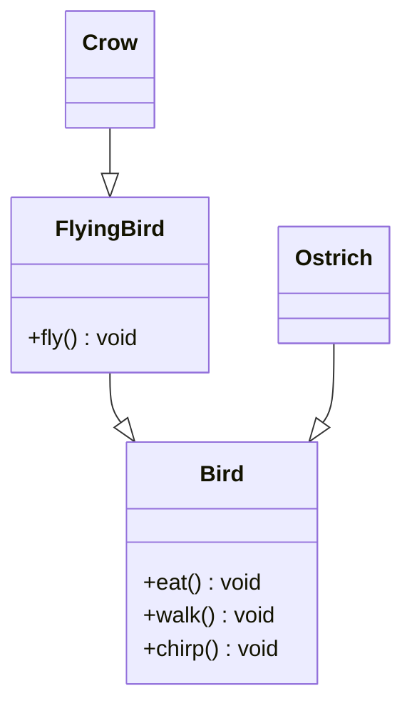

```cpp
class Bird {
 public:
  virtual void eat() = 0;

  virtual void walk() = 0;

  virtual void chirp() = 0;

  virtual ~Bird() {}
};

class FlyingBird : public Bird {
 public:
  virtual void fly() = 0;

  ~FlyingBird() {}
};

class Crow : public FlyingBird {
 public:
  void eat() override {
    cout << "乌鸦喝水" << endl;
  }

  void walk() override {
    cout << "乌鸦散步" << endl;
  }

  void chirp() override {
    cout << "乌鸦蹦蹦跳跳" << endl;
  }

  void fly() override {
    cout << "乌鸦飞翔" << endl;
  }
};

class Ostrich : public Bird {
 public:
  void eat() override {
    cout << "鸵鸟吃东西" << endl;
  }

  void walk() override {
    cout << "鸵鸟散步" << endl;
  }

  void chirp() override {
    cout << "鸵鸟蹦蹦跳跳" << endl;
  }
};
```

### 依赖倒置原则

依赖倒置原则（Dependency Inversion Principle, DIP）是面向对象设计中的一项关键原则，它提出了两个主要的指导方针：高层模块不应该依赖低层模块，两者都应该依赖抽象；抽象不应该依赖于细节，细节应该依赖于抽象。这意味着在设计系统时，应该以抽象的方式定义组件之间的关系，而不是依赖于具体的实现。

依赖倒置原则的核心在于面向接口编程，而非面向实现编程。遵循这一原则，可以让系统更加灵活和可维护。在代码中，这意味着应当使用接口或抽象类来声明变量类型、参数类型、返回类型以及执行类型转换，而不是直接使用具体类。

依赖倒置原则是实现开闭原则的重要手段之一。通过依赖抽象而非具体实现，系统可以在不修改源代码的情况下进行扩展。具体类的对象可以通过配置文件来指定，从而在运行时注入到系统中。这样，如果需要改变系统的行为，只需添加新的具体类并在配置文件中进行修改，而无需改动现有的代码。

为了实现依赖倒置原则，通常采用依赖注入（Dependency Injection, DI）的手法。依赖注入有几种不同的形式：

1. **构造注入**（Constructor Injection）： 通过构造函数将依赖的对象传递给需要它的类。
2. **设值注入**（Setter Injection）： 通过 Setter 方法将依赖的对象设置到需要它的类中。
3. **接口注入**（Interface Injection）： 通过在接口中声明的方法来传递依赖的对象。

在这些注入方式中，定义时使用的是抽象类型，在运行时再传入具体类型的对象。这样做可以确保系统的高层组件不依赖于具体的低层组件，而是由低层组件依赖于高层组件定义的抽象。

依赖倒置原则、开闭原则和里氏代换原则经常一起使用。开闭原则是面向对象设计的目标，即软件实体应当对扩展开放，对修改关闭。里氏代换原则是实现开闭原则的基础，确保派生类可以替换其基类。而依赖倒置原则是实现这些目标的手段，通过依赖抽象来减少模块间的耦合。

综合这些原则，可以设计出灵活、可维护和可扩展的系统。依赖倒置原则通过提升抽象层的地位，降低了系统各部分之间的依赖关系，从而使得系统更容易适应变化。

例子：银行业务类。

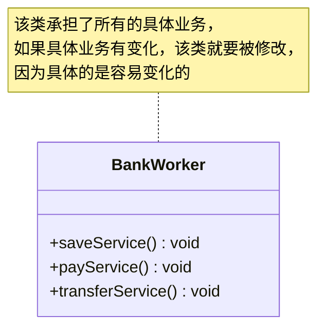

```cpp
class BankWorker {
 public:
  void saveService() {
    cout << "办理存款业务" << endl;
  }

  void payService() {
    cout << "办理支付业务" << endl;
  }

  void transferService() {
    cout << "办理转账业务" << endl;
  }
};

void doSaveBusiness(BankWorker *worker) {
  worker->saveService();
}

void doPayBusiness(BankWorker *worker) {
  worker->payService();
}

void doTransferBusiness(BankWorker *worker) {
  worker->transferService();
}

void test() {
  unique_ptr<BankWorker> worker(new BankWorker());
  doSaveBusiness(worker.get());
  doPayBusiness(worker.get());
  doTransferBusiness(worker.get());
}
```

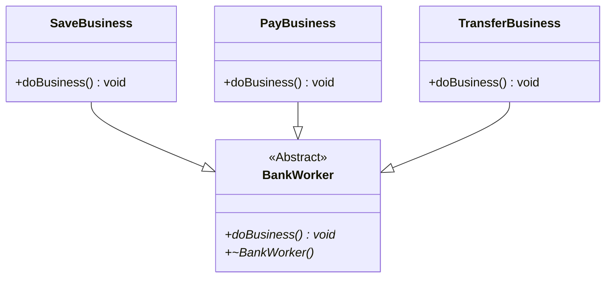

```cpp
class BankWorker {
 public:
  virtual void doBusiness() = 0;

  virtual ~BankWorker() {}
};

class SaveBankWorker
    : public BankWorker {
 public:
  void doBusiness() override {
    cout << "办理存款业务" << endl;
  }
};

class PayBankWorker
    : public BankWorker {
 public:
  void doBusiness() override {
    cout << "办理支付业务" << endl;
  }
};

class TransferBankWorker
    : public BankWorker {
 public:
  void doBusiness() override {
    cout << "办理转账业务" << endl;
  }
};

void doBusiness(BankWorker *worker) {
  worker->doBusiness();
}

void test() {
  unique_ptr<BankWorker> saveWorker(new SaveBankWorker());
  unique_ptr<BankWorker> payWorker(new PayBankWorker());
  unique_ptr<BankWorker> transferWorker(new TransferBankWorker());
  doBusiness(saveWorker.get());
  doBusiness(payWorker.get());
  doBusiness(transferWorker.get());
}
```

### 迪米特法则

迪米特法则（Law of Demeter），也称为最少知识原则（Least Knowledge Principle），是面向对象设计中的一个原则，它规定了一个软件实体应当尽可能少地与其他实体发生相互作用。这个原则的核心在于降低系统组件之间的耦合度，使得系统更加模块化，从而提高系统的可维护性和可扩展性。

根据迪米特法则，如果一个系统遵循这一原则，那么当系统中的某一个模块需要修改时，对其他模块的影响会降到最低，这使得系统的扩展和维护相对容易。迪米特法则要求限制软件实体之间通信的宽度和深度，从而减少各个模块之间的依赖。

在实践中，迪米特法则建议我们应该只与直接的朋友类交互，而不是与“陌生人”类交互。一个对象的朋友包括：

1. 当前对象本身（`this`）。
2. 以参数形式传入到当前对象方法中的对象。
3. 当前对象的成员对象。
4. 当前对象的成员对象是一个集合时，集合中的元素。
5. 当前对象所创建的对象。

除了这些朋友之外的其他对象都视为“陌生人”。迪米特法则要求对象只与直接朋友交互，而不与“陌生人”直接交互，以此来降低系统的耦合度。

应用迪米特法则时，需要注意以下几点：

- **创建松耦合的类**：在类的设计上，应该尽量降低类之间的耦合度，这样修改一个类时，对其他类的影响最小。
- **降低访问权限**：在类的结构设计上，应该尽量降低成员变量和成员函数的访问权限，以减少外部对类的直接干预。
- **设计不变类**：在可能的情况下，应该设计类为不变类，即对象的状态在创建后不能被改变。
- **减少对其他类的引用**：一个对象对其他对象的引用应该降到最低，尽量通过间接的方式来实现对象间的交互。

迪米特法则通过引入合理的“第三者”来降低现有对象之间的耦合度。例如，如果类 A 需要调用类 C 的方法，但类 A 和类 C 不是朋友关系，那么可以通过类 B 来转发这个调用，使得类 A 和类 C 之间没有直接的依赖关系。

迪米特法则强调了在设计系统时应该尽量减少对象之间的直接交互，以降低系统的耦合度，提高系统的稳定性和可维护性。通过这种方式，可以构建出更加健壮和灵活的软件系统。

例如：使用买房者购房的一个例子。


A 方案，购房者需要挨个楼盘的去知道确切的消息，需要对每个楼盘都有详细的了解，而 B 方案是购房者可以不用知道每个楼盘的具体信息，直接找个中介，告诉中介自己的需求，让中介进行推荐，这样购房 者与楼盘之间的关系就不是那么强相关。 

方案 A 的代码实现

```cpp
class Building {
 public:
  virtual void sale() = 0;

  virtual string getQuality() = 0;

  virtual ~Building() {}
};

class WankeBuilding : public Building {
 public:
  WankeBuilding() : _quality("高品质") {
  }

  void sale() override {
    cout << "万科楼盘" << _quality << "的房子被出售" << endl;
  }

  string getQuality() override {
    return _quality;
  }

 private:
  string _quality;
};

class HengdaBuilding : public Building {
 public:
  HengdaBuilding() : _quality("低品质") {
  }

  void sale() override {
    cout << "恒大楼盘" << _quality << "的房子被出售" << endl;
  }

  string getQuality() override {
    return _quality;
  }

 private:
  string _quality;
};

void test() {
  Building *pbuidingA = new WankeBuilding();
  Building *pbuidingB = new HengdaBuilding();
  string demand = "低品质";
  if (pbuidingA->getQuality() == demand) {
    pbuidingA->sale();
  }
  if (pbuidingB->getQuality() == demand) {
    pbuidingB->sale();
  }
}
```

方案 B 的代码实现

```cpp
class Mediator {
 public:
  Mediator() {
    Building *pbuildingA = new WankeBuilding();
    Building *pbuildingB = new HengdaBuilding();
    _buildings.push_back(pbuildingA);
    _buildings.push_back(pbuildingB);
  }

  Building *findBuilding(const string &quality) {
    for (auto &building : _buildings) {
      if (building->getQuality() == quality) {
        return building;
      }
    }
    return nullptr;
  }

  ~Mediator() {
    for (auto &building : _buildings) {
      if (building) {
        delete building;
      }
    }
  }

 private:
  vector<Building *> _buildings;
};

void test() {
  string demand = "低品质";
  Mediator mediator;
  Building *pbuilding = mediator.findBuilding(demand);
  if (pbuilding) {
    pbuilding->sale();
  } else {
    cout << "没有符合要求的楼盘" << endl;
  }
}
```

### 组合复用原则

组合复用原则（Composite/Aggregate Reuse Principle）是面向对象设计中提倡的一种复用策略，它建议在设计时优先考虑使用组合或聚合等关联关系来复用代码，而不是依赖于继承。这个原则的核心思想是通过将已有的对象纳入新对象中，使新对象能够通过委托调用已有对象的方法来复用功能。

组合复用原则强调的是在复用时应该尽量使用“Has-A”关系，即新对象包含已有对象，这些对象成为新对象的一部分。这种关系是“黑箱”复用，新对象不需要了解成员对象的内部实现细节，成员对象的变化对新对象的影响相对较小，从而降低了类与类之间的耦合度。

相比之下，继承是一种“白箱”复用，因为继承会将基类的实现细节暴露给派生类。如果基类发生改变，派生类的实现可能也需要随之改变，这增加了系统的脆弱性。此外，继承而来的实现是静态的，无法在运行时改变，这限制了系统的灵活性。继承还只能在某些特定的环境下使用，比如当类没有被声明为不可继承时。

组合复用原则的优点包括：

1. **灵活性**：组合提供了更高的灵活性，因为对象之间的依赖关系是在运行时建立的，可以根据需要动态地更换成员对象。

2. **降低耦合度**：组合关系使得成员对象的变化对新对象的影响较小，从而降低了系统的耦合度。

3. **封装性**：组合关系保持了成员对象的封装性，新对象不需要了解成员对象的内部实现。

4. **选择性复用**：新对象可以有选择性地调用成员对象的操作，而不是继承所有基类的方法。

在实际应用中，如果两个类之间是“Is-A”关系，即一个类是另一个类的具体类型，可以使用继承。而如果两个类之间是“Has-A”关系，即一个类包含另一个类的对象，应该使用组合或聚合。这种区分有助于决定在特定的设计情况下应该使用继承还是组合/聚合来实现复用。

组合复用原则鼓励设计者在构建系统时更多地使用组合关系来复用代码，从而创建出更加灵活、松耦合的系统。这种设计方法有助于提高系统的可维护性和可扩展性，使得系统更容易适应未来的变化。

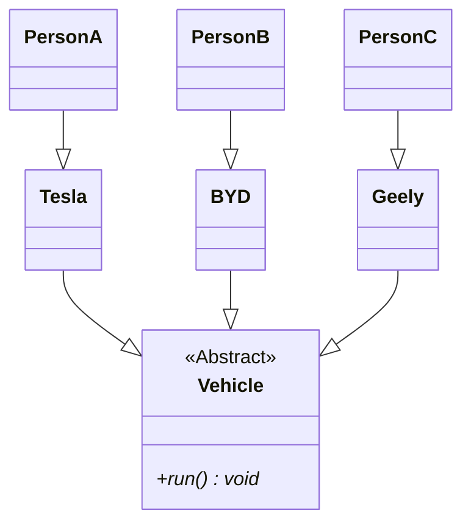

```cpp
class Vehicle {
 public:
  virtual void run() = 0;

  virtual ~Vehicle() {}
};

class Tesla : public Vehicle {
 public:
  void run() override {
    cout << "Model Y start..." << endl;
  }
};

class BYD : public Vehicle {
 public:
  void run() override {
    cout << "汉EV start..." << endl;
  }
};

class Geely : public Vehicle {
 public:
  void run() override {
    cout << "Geely LYNK03 start..." << endl;
  }
};

class PersonA : public Tesla {
};

class PersonB : public BYD {
};

class PersonC : public Geely {
};

void test() {
  PersonA pa;
  pa.run();
  PersonB pb;
  pb.run();
  PersonC pc;
  pc.run();
}
```

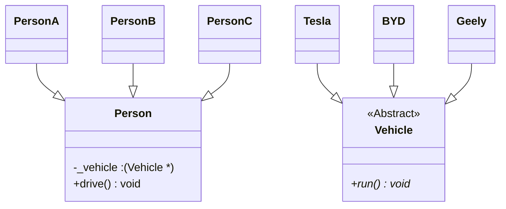

```cpp
class Vehicle {
 public:
  virtual void run() = 0;

  virtual ~Vehicle() {}
};

class Tesla : public Vehicle {
 public:
  void run() override {
    cout << "Model Y start..." << endl;
  }
};

class BYD : public Vehicle {
 public:
  void run() override {
    cout << "汉EV start..." << endl;
  }
};

class Geely : public Vehicle {
 public:
  void run() override {
    cout << "Geely LYNK03 start..." << endl;
  }
};

class Person {
 public:
  void getVehicle(Vehicle *vehicle) {
    _vehicle = vehicle;
  }

  void drive() {
    _vehicle->run();
  }

 private:
  Vehicle *_vehicle;
};

void test() {
  Person person;
  unique_ptr<Vehicle> tesla(new Tesla());
  unique_ptr<Vehicle> han(new BYD());
  unique_ptr<Vehicle> geely(new Geely());
  person.getVehicle(tesla.get());
  person.drive();
  person.getVehicle(han.get());
  person.drive();
  person.getVehicle(geely.get());
  person.drive();
}
```

### 七大设计原则的总结 

原则的目的只有一个：降低对象之间的耦合，增加程序的可复用性、可扩展性和可维护性。

| 设计原则名称 | 设计原则简介                                                 | 重要性 |
| ------------ | ------------------------------------------------------------ | ------ |
| 单一职责原则 | 类的职责要单一，不能将太多的职责放在一个类中                 | ★★★★☆  |
| 开闭原则     | 软件实体对扩展是开放的，但对修改是关闭的，即在不修改一个软件的基础上去扩展其功能 | ★★★★★  |
| 里氏替换原则 | 在软件系统中，一个可以接受基类对象的地方必然可以接收一个派生类对象 | ★★★★☆  |
| 依赖倒置原则 | 要针对抽象编程，而不是针对具体编程                           | ★★★★★  |
| 接口隔离原则 | 使用多个专门的接口来取代一个统一的接口                       | ★★☆☆☆  |
| 迪米特法则   | 一个软件实体对其他实体的引用越少越好，或者说如果两个类彼此直接通信，那么这两个类就不应当发生直接相互作用，而是通过引入一个第三者发生间接交互 | ★★★☆☆  |
| 合成复用原则 | 在系统中应该尽量多使用组合和聚合关联关系，尽量少使用甚至不使用继承关系 | ★★★★☆  |

## 设计模式

设计模式分为三种不同类型的模式。

创建型模式（Creational patterns）5 种：提供对象创建机制，增加现有代码的灵活性和重用

| 类型         | 模式名称                 | 学习难度 | 使用频率 |
| ------------ | ------------------------ | -------- | -------- |
| 单例模式     | Singleton Pattern        | ★☆☆☆☆    | ★★★★☆    |
| 简单工厂模式 | Simple Factory Pattern   | ★★☆☆☆    | ★★★☆☆    |
| 工厂方法模式 | Factory Method Pattern   | ★★☆☆☆    | ★★★★★    |
| 抽象工厂模式 | Abstract Factory Pattern | ★★★★☆    | ★★★★★    |
| 原型模式     | Prototype Pattern        | ★★★☆☆    | ★★★☆☆    |
| 建造者模式   | Builder Pattern          | ★★★☆☆    | ★★☆☆☆    |

结构型模式（Structural patterns）7 种：解释如何将对象和类组装成更大的结构，同时保持结构的灵活性和高效性。

| 类型       | 模式名称          | 学习难度 | 使用频率 |
| ---------- | ----------------- | -------- | -------- |
| 适配器模式 | Adapter Pattern   | ★★☆☆☆    | ★★★★☆    |
| 桥接模式   | Bridge Pattern    | ★★★☆☆    | ★★★☆☆    |
| 组合模式   | Composite Pattern | ★★★☆☆    | ★★★★☆    |
| 装饰模式   | Decorator Pattern | ★★★☆☆    | ★★★☆☆    |
| 外观模式   | Facade Pattern    | ★☆☆☆☆    | ★★★★★    |
| 享元模式   | Flyweight Pattern | ★★★★☆    | ★☆☆☆☆    |
| 代理模式   | Proxy Pattern     | ★★★☆☆    | ★★★★☆    |

行为型模式（Behavioral patterns）11 种：负责有效的沟通和对象之间的责任分配。

| 类型         | 模式名称                        | 学习难度 | 使用频率 |
| ------------ | ------------------------------- | -------- | -------- |
| 职责链模式   | Chain of Responsibility Pattern | ★★★☆☆    | ★★☆☆☆    |
| 命令模式     | Command Pattern                 | ★★★☆☆    | ★★★★☆    |
| 解释器模式   | Interpreter Pattern             | ★★★★★    | ★☆☆☆☆    |
| 迭代器模式   | Iterator Pattern                | ★★★☆☆    | ★★★★★    |
| 中介者模式   | Mediator Pattern                | ★★★☆☆    | ★★☆☆☆    |
| 备忘录模式   | Memento Pattern                 | ★★☆☆☆    | ★★☆☆☆    |
| 观察者模式   | Observer Pattern                | ★★★☆☆    | ★★★★★    |
| 状态模式     | State Pattern                   | ★★★☆☆    | ★★★☆☆    |
| 策略模式     | Strategy Pattern                | ★☆☆☆☆    | ★★★★☆    |
| 模板方法模式 | Template Method Pattern         | ★★☆☆☆    | ★★★☆☆    |
| 访问者模式   | Visitor Pattern                 | ★★★★☆    | ★☆☆☆☆    |

### 简单工厂

#### 概述 

简单工厂模式又叫静态工厂方法模式。提供一个工厂类，在工厂类中做判断，根据传入的类型创造相应的产品。当增加新的产品时，就需要修改工厂类。简单工厂模式提供了专门的工厂类用于创建对象，将对象的创建和对象的使用分离开，它作为一种最简单的工厂模式在软件开发中得到了较为广泛的应用。

#### 类图

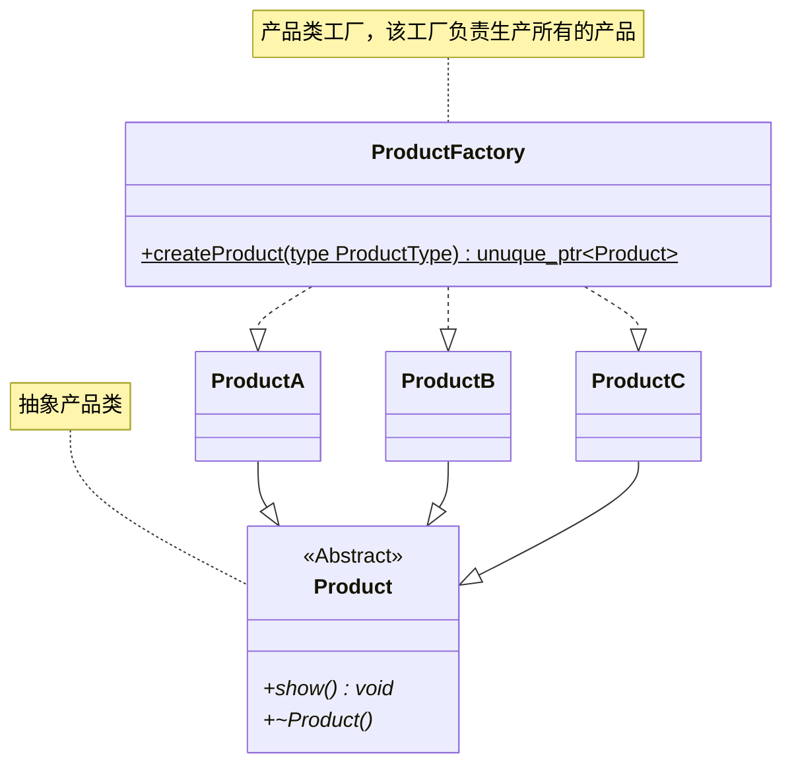

```cpp
enum ProductType {
  TypeA,
  TypeB,
  TypeC
};

//抽象产品类
class Product {
 public:
  virtual void show() = 0;

//抽象类的析构函数设置为虚函数
  virtual ~Product() {}
};

class ProductA : public Product {
 public:
  ProductA() {
    cout << "ProductA()" << endl;
  }

  void show() override {
    cout << "void ProductA::show()" << endl;
  }

  ~ProductA() {
    cout << "~ProductA()" << endl;
  }
};

class ProductB : public Product {
 public:
  ProductB() {
    cout << "ProductB()" << endl;
  }

  void show() override {
    cout << "void ProductB::show()" << endl;
  }

  ~ProductB() {
    cout << "~ProductB()" << endl;
  }
};

class ProductC : public Product {
 public:
  ProductC() {
    cout << "ProductC()" << endl;
  }

  void show() override {
    cout << "void ProductC::show()" << endl;
  }

  ~ProductC() {
    cout << "~ProductC()" << endl;
  }
};

class ProductFactory {
 public:
  static unique_ptr<Product> createProduct(ProductType type) {
    switch (type) {
      case TypeA:return unique_ptr<Product>(new ProductA());
      case TypeB:return unique_ptr<Product>(new ProductB());
      case TypeC:return unique_ptr<Product>(new ProductC());
      default: return unique_ptr<Product>(nullptr);
    }
  }
};

void test() {
  unique_ptr<Product> pa = ProductFactory::createProduct(TypeA);
  unique_ptr<Product> pb = ProductFactory::createProduct(TypeB);
  unique_ptr<Product> pc = ProductFactory::createProduct(TypeC);
  pa->show();
  pb->show();
  pc->show();
}
```

#### 优点 

1. 工厂类包含必要的判断逻辑，可以决定在什么时候创建哪一个产品类的实例，客户端可以免除直接创建产品对象的职责，而仅仅“消费”产品，简单工厂模式实现了对象创建和使用的分离
2. 客户端无须知道所创建的具体产品类的类名，只需要知道具体产品类所对应的参数即可，对于一些复杂的类名，通过简单工厂模式可以在一定程度减少使用者的记忆量
3. 通过引入配置文件，可以在不修改任何客户端代码的情况下更换和增加新的具体产品类，在一定程度上提高了系统的灵活性

#### 缺点

1. 由于工厂类集中了所有产品的创建逻辑，职责过重，一旦不能正常工作，整个系统都要受到影响
2. 使用简单工厂模式势必会增加系统中类的个数（引入新的工程类），增加了系统的复杂度和理解难度
3. 系统拓展困难，一旦添加了新的产品就不得不修改工厂逻辑，在产品类型较多时，有可能造成工厂逻辑过于复杂，不利于系统的拓展和维护
4. 简单工厂模式由于使用了静态工厂方法，造成工厂角色无法形成基于继承的等级结构

#### 使用场景

1. 工厂类负责创建的对象比较少，由于创建的对象较少，不会造成工厂方法中的业务逻辑太过复杂。
2. 客户端只知道传入工厂类的参数，对于如何创建对象并不关心。

### 工厂方法

#### 概述

在软件开发及运行过程中，经常需要创建对象，但常出现由于需求的变更，需要创建的对象的具体类型也要经常变化。工厂方法通过采取虚函数的方法，实现了使用者和具体类型之间的解耦，可以用来解决这个问题。工厂方法模式对简单工厂模式中的工厂类进一步抽象。核心工厂类不再负责产品的创建，而是演变为一个抽象工厂角色，仅负责定义具体工厂子类必须实现的接口。同时，针对不同的产品提供不同的工厂。即每个产品都有一个与之对应的工厂。这样，系统在增加新产品时就不会修改工厂类逻辑而是添加新的工厂子类，从而弥补简单工厂模式对修改开放的缺陷。定义一个创建对象的接口，让子类决定实例化哪个类。该模式使类对象的创建延迟到子类。

#### 类图

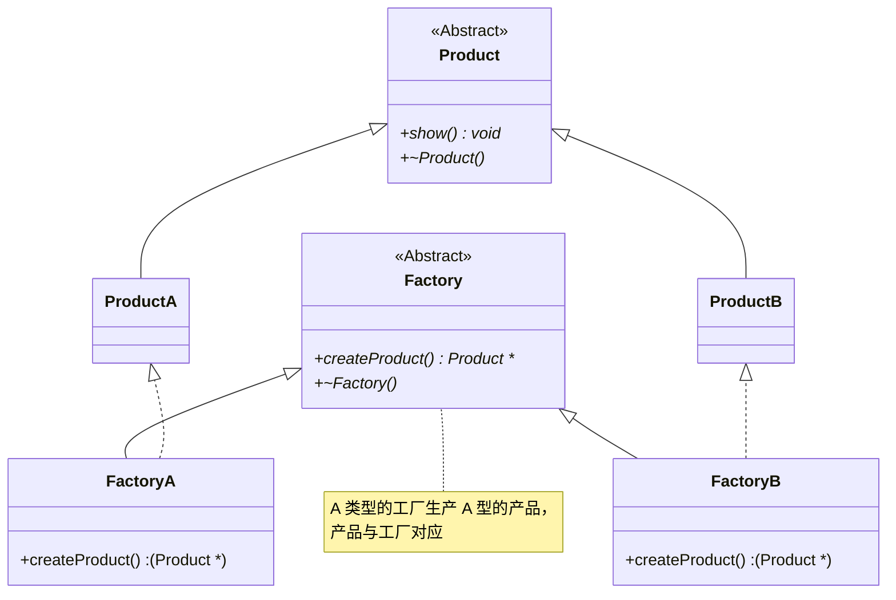

```cpp
// 产品抽象类
class Product {
 public:
  virtual void show() = 0;

  virtual ~Product(){}
};

class ProductA : public Product {
 public:
  ProductA() {
    cout << "ProductA()" << endl;
  }

  void show() override {
    cout << "void ProductA::show()" << endl;
  }

  ~ProductA() {
    cout << "~ProductA()" << endl;
  }
};

class ProductB : public Product {
 public:
  ProductB() {
    cout << "ProductB()" << endl;
  }

  void show() override {
    cout << "void ProductB::show()" << endl;
  }

  ~ProductB() {
    cout << "~ProductB()" << endl;
  }
};

class Factory {
 public:
  virtual Product *createProduct() = 0;

  virtual ~Factory(){}
};

class FactoryA : public Factory {
 public:
  FactoryA() {
    cout << "FactoryA()" << endl;
  }

  Product *createProduct() override {
    return new ProductA();
  }

  ~FactoryA() {
    cout << "~FactoryA()" << endl;
  }
};

class FactoryB : public Factory {
 public:
  FactoryB() {
    cout << "FactoryB()" << endl;
  }

  Product *createProduct() override {
    return new ProductB();
  }

  ~FactoryB() {
    cout << "~FactoryB()" << endl;
  }
};

void test() {
// 生产产品 A
  unique_ptr<Factory> factoryA(new FactoryA());
  unique_ptr<Product> productA(factoryA->createProduct());
  productA->show();
// 生产产品 B
  cout << endl << endl;
  unique_ptr<Factory> factoryB(new FactoryB());
  unique_ptr<Product> productB(factoryB->createProduct());
  productB->show();
}
```

#### 优点 

1. 用户只需要知道具体工厂的名称就可得到所要的产品，无须知道产品的具体创建过程。 
2. 灵活性增强，对于新产品的创建，只需多写一个相应的工厂类。 
3. 典型的解耦框架。高层模块只需要知道产品的抽象类，无须关心其他实现类，满足迪米特法则、依赖倒置原则和里氏替换原则。 
4. 对扩展开放对修改关闭；解决了简单工厂的缺点问题。

#### 缺点

1. 类的个数容易过多，增加复杂度
2. 增加了系统的抽象性和理解难度
3. 接口的传入参数类型需要一致，且只能对单一变化量接口使用 
4. 抽象产品只能生产一种产品，此弊端可使用抽象工厂模式解决。

#### 应用场景

1. 客户只知道创建产品的工厂名，而不知道具体的产品名。 
2. 创建对象的任务由多个具体子工厂中的某一个完成，而抽象工厂只提供创建产品的接口。 
3. 客户不关心创建产品的细节，只关心产品的品牌

### 抽象工厂 

在软件开发及运行过程中，经常面临着“一系列相互依赖的对象”的创建工作；而由于需求的变化，常常 存在更多系列对象的创建问题。 

定义：提供一个接口，该接口负责创建一系列“相关或者相互依赖的对象”，无需指定它们具体的类。

#### 类图

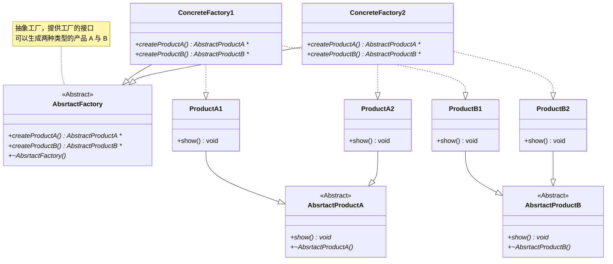

```cpp
// A 类型的抽象产品
class AbstractProductA {
 public:
  virtual void show() = 0;

  ~AbstractProductA(){}
};

// B 类型的抽象产品
class AbstractProductB {
 public:
  virtual void show() = 0;

  ~AbstractProductB(){}
};

class ProductA1 : public AbstractProductA {
 public:
  virtual void show() override {
    cout << "void ProductA1::show()" << endl;
  }
};

class ProductA2 : public AbstractProductA {
 public:
  virtual void show() override {
    cout << "void ProductA2::show()" << endl;
  }
};

class ProductB1 : public AbstractProductB {
 public:
  virtual void show() override {
    cout << "void ProductB1::show()" << endl;
  }
};

class ProductB2 : public AbstractProductB {
 public:
  virtual void show() override {
    cout << "void ProductB2::show()" << endl;
  }
};

class AbstractFactory {
 public:
  virtual AbstractProductA *createProductA() = 0;

  virtual AbstractProductB *createProductB() = 0;

  ~AbstractFactory(){}
};

class ConcreteFactory1 : public AbstractFactory {
 public:
  AbstractProductA *createProductA() override {
    return new ProductA1();
  }

  AbstractProductB *createProductB() override {
    return new ProductB1();
  }
};

class ConcreteFactory : public AbstractFactory {
 public:
  AbstractProductA *createProductA() override {
    return new ProductA2();
  }

  AbstractProductB *createProductB() override {
    return new ProductB2();
  }
};

void test() {
  AbstractFactory *factory1 = new ConcreteFactory1();
  AbstractProductA *productA = factory1->createProductA();
  AbstractProductB *productB = factory1->createProductB();
  productA->show();
  productB->show();
  cout << endl;
  AbstractFactory *factory2 = new ConcreteFactory2();
  productA = factory2->createProductA();
  productB = factory2->createProductB();
  productA->show();
  productB->show();
}
```

#### 优点

1. 抽象工厂模式隔离了具体类的生成，使得客户端并不需要知道什么被创建。 
2. 当一个产品族中的多个对象被设计成一起工作时，它能够保证客户端始终只使用同一产品族中的对象； 
3. 增加新的产品族很方便（生成新的具体工厂），无需修改已有系统代码，符合开闭原则；

#### 缺点 

增加新的产品等级结构很复杂，需要修改抽象工厂和所有的具体工厂类，对“开闭原则”的支持呈现倾斜性。

#### 应用场景

1. 用户无需关心对象的创建过程，将对象的创建和使用解耦； 
2. 产品等级结构稳定，在设计完成之后不会向系统中增加新的产品等级结构或者删除已有的产品等级结构； 
3. 系统中有多于一个的产品族，而每次只使用其中某一产品族。可以通过配置文件等方式来使用户能够动态改变产品族，也可以很方便的增加新的产品族

### 观察者模式 

在 GOF 的《设计模式：可复用面向对象软件的基础》一书中对观察者模式是这样定义的：定义对象的一种一对多的依赖关系，当一个对象的状态发生改变时，所有依赖于它的对象都得到通知并被自动更新。 当一个对象发生了变化，关注它的对象就会得到通知；这种交互也成为发布-订阅（publishsubscribe）。

#### 类图

```mermaid
classDiagram
	class Subject {
		<<Abstract>>
		+attach(Observer *) void*
		+detach(Observer *) void*
		+notify() void*
		+~Subject()*
	}
	
	class Observer {
		<<Abstract>>
		+update(status int) void*
		+~Observer()*
	}
	
	class ConcreateSubject {
		-_oblist: list~Observer *~
		-_status: int
		+attach(Observer *) void
		+detach(Observer *) void
		+notify() void
		+setStaus(int) void
		+getStatus() int
	}
	
	class ConcreateObserver1 {
		+update(int) void
	}
	
	class ConcreateObserver2 {
		+update(int) void
	}
	
	ConcreateSubject --|> Subject 
	ConcreateObserver1 --|> Observer
	ConcreateObserver2 --|> Observer
	
	Subject ..|> Observer
```

```cpp
#include <iostream>
#include <list>
#include <algorithm>
#include <string>

using std::cout;
using std::endl;
using std::list;
using std::find;
using std::string;

class Observer;

class Subject {
 public:
  virtual void attach(Observer *pObserver) = 0;

  virtual void detach(Observer *pObserver) = 0;

  virtual void notify() = 0;

  virtual ~Subject() {}
};

class ConcreteSubject : public Subject {
 public:
  void attach(Observer *pObserver) override;

  void detach(Observer *pObserver) override;

  void notify() override;

  void setStatus(int status) {
    _status = status;
  }

  int getStatus() const {
    return _status;
  }

 private:
  list<Observer *> _obList;
  int _status;
};

class Observer {
 public:
  virtual void update(int) = 0;

  virtual ~Observer() {}
};

class ConcreteObserver : public Observer {
 public:
  ConcreteObserver(const string &name)
      : _name(name) {
  }

  void update(int value) {
    cout << "ConcreteObserver " << _name << ", value = " << value << endl;
  }

 private:
  string _name;
};

class ConcreteObserver2 : public Observer {
 public:
  ConcreteObserver2(const string &name) : _name(name) {
  }

  void update(int value) {
    cout << "ConcreteObserver2 " << _name << ", value = " << value << endl;
  }

 private:
  string _name;
};

void ConcreteSubject::attach(Observer *pObserver) {
  if (pObserver) {
    _obList.push_back(pObserver);
  }
}

void ConcreteSubject::detach(Observer *pObserver) {
  if (pObserver) {
    _obList.remove(pObserver);
  }
}

void ConcreteSubject::notify() {
  for (auto &ob : _obList) {
    ob->update(_status);
  }
}

void test() {
  unique_ptr<ConcreteSubject> pSubject(new ConcreteSubject());
  unique_ptr<Observer> pObserver(new ConcreteObserver("lili"));
  unique_ptr<Observer> pObserver2(new ConcreteObserver2("lucy"));
  pSubject->setStatus(2);
  pSubject->attach(pObserver.get());
  pSubject->attach(pObserver2.get());
  pSubject->notify();
  pSubject->detach(pObserver2.get());
  pSubject->setStatus(3);
  pSubject->notify();
}
```

#### 优点 

1. 观察者和被观察者是抽象耦合的
2. 建立一套触发机制。 

#### 缺点 

1. 如果一个被观察者对象有很多的直接和间接的观察者的话，将所有的观察者都通知到会花费很多时间。
2. 如果在观察者和观察目标之间有循环依赖的话，观察目标会触发它们之间进行循环调用，可能导致 系统崩溃。 
3. 观察者模式没有相应的机制让观察者知道所观察的目标对象是怎么发生变化的，而仅仅只是知道观 察目标发生了变化。

#### 应用场景

1. 一个抽象模型有两个方面，其中一个方面发依赖于另外一个方面。将这些方面封装在独立的对象中 使它们可以各自独立地改变和复用。
2. 一个对象的改变将导致其它一个或多个对象发生改变，而不知道具体有多少对象将发生改变，可以 降低对象之间的耦合度。 
3. 一个对象必须通知其他对象，而并不知道这些对象是谁。 
4. 需要在系统中创建一个触发链，A 对象的行为将影响 B 对象，B 对象的行为将影响 C 对象……，可以使用观察者模式创建一种链式触发机制

