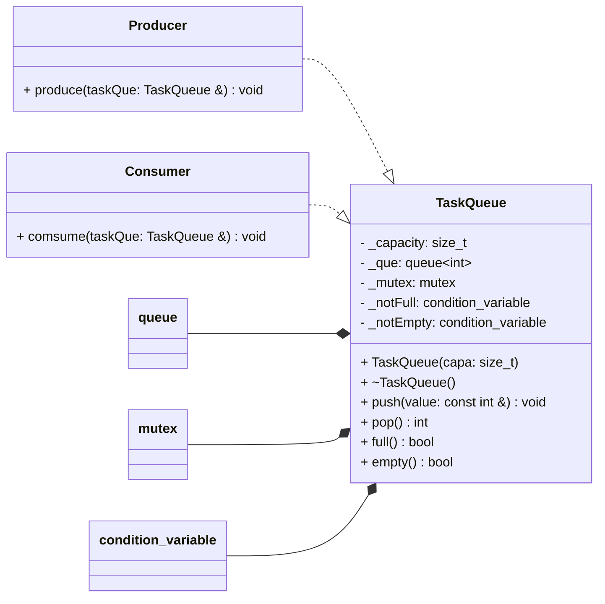
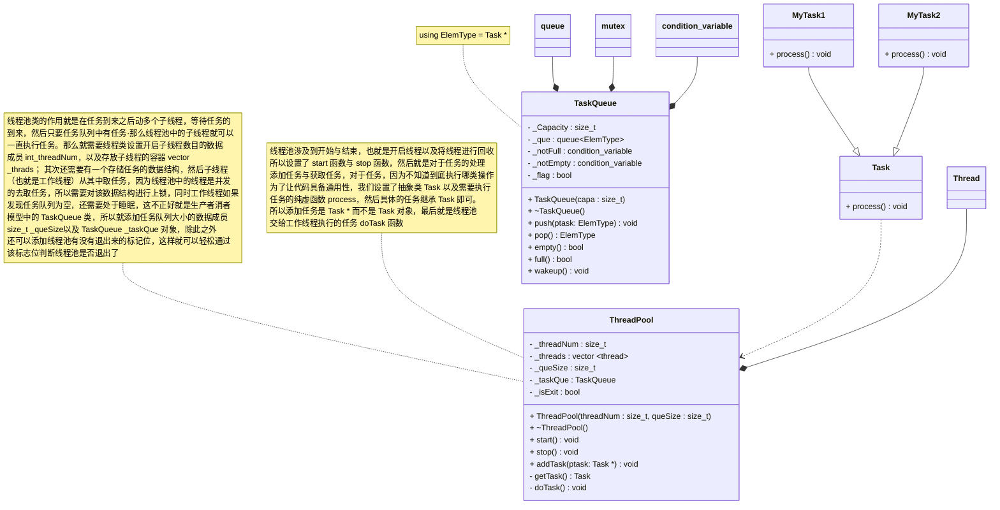
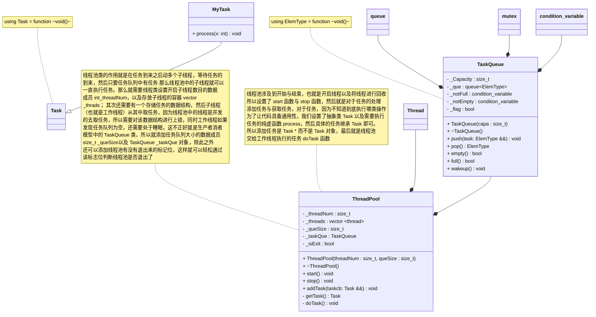

## C++11 线程

### 函数接口


### 线程 id 的获取


`````cpp
// 此处的 get_id 是成员函数，说明需要使用对象进行调用
std::thread::id get_id() const noexcept;

// 此处的 get_id 是 std::this_thread 命令空间中的一个实体，就是个普通函数
std::thread::id get_id() noexcept;
`````

```cpp
void foo() {
  this_thread::sleep_for(chrono::seconds(1));
}

int main() {
  thread t1(foo);
  thread::id t1_id = t1.get_id();

  thread t2(foo);
  thread::id t2_id = t2.get_id();

  cout << "t1 的 id: " << t1_id << '\n';
  cout << "t2 的 id: " << t2_id << '\n';

  t1.join();
  t2.join();

  cout << "合并后 t1 的 id: " << t1.get_id() << '\n';
  cout << "合并后 t2 的 id: " << t2.get_id() << '\n';
}
```


### 线程的等待


```cpp
void foo() {
  // 模拟耗费大量资源的操作
  this_thread::sleep_for(std::chrono::seconds(1));
}

void bar() {
  // 模拟耗费大量资源的操作
  this_thread::sleep_for(std::chrono::seconds(1));
}

int main() {
  cout << "启动第一助手...\n";
  thread helper1(foo);

  cout << "启动第二助手...\n";
  thread helper2(bar);

  cout << "等待助手结束..." << endl;
  helper1.join();
  helper2.join();

  std::cout << "完成!\n";
}
```

### 线程入口函数的传参

#### 普通函数

```cpp
void threadFunc(int x) {
  cout << "void threadFunc(int)" << endl;
  cout << "child thread id = " << std::this_thread::get_id() << endl;
  cout << "x = " << x << endl;
}

int main() {
  cout << "main thread id = " << std::this_thread::get_id() << endl;
  thread th(threadFunc, 1); // 创建线程对象 th
  cout << "child1 thread id = " << th.get_id() << endl;

  th.join(); // 让主线程等待子线程
  return 0;
}
```

#### 函数指针

```cpp
void threadFunc(int x) {
  cout << endl << "void threadFunc(int)" << endl;
  cout << "child thread id = " << std::this_thread::get_id() << endl;
  cout << "x = " << x << endl;
}

int main() {
  cout << "main thread id = " << std::this_thread::get_id() << endl;

  typedef void (*pFunc)(int); // 定义函数指针类型的方式
  pFunc f = &threadFunc;

  thread th(f, 2);  // 创建线程对象 th
  cout << "child1 thread id = " << th.get_id() << endl;

  th.join(); // 让主线程等待子线程
  return 0;
}
```

#### 函数引用

```cpp
void threadFunc(int x) {
  cout << endl << "void threadFunc(int)" << endl;
  cout << "child thread id = " << std::this_thread::get_id() << endl;
  cout << "x = " << x << endl;
}

int main() {
  cout << "main thread id = " << std::this_thread::get_id() << endl;

  typedef void (&pFunc)(int); // 定义函数引用类型的方式
  pFunc f = threadFunc;

  thread th(f, 3); // 创建线程对象 th
  cout << "child1 thread id = " << th.get_id() << endl;

  th.join(); // 让主线程等待子线程
  return 0;
}
```

#### 函数对象

```cpp
class Example {
 public:
  void operator()(int x) {
    cout << endl << "void threadFunc(int)" << endl;
    cout << "child thread id = " << std::this_thread::get_id() << endl;
    cout << "x = " << x << endl;
  }
};

int main() {
  cout << "main thread id = " << std::this_thread::get_id() << endl;

  Example ex;

  thread th(ex, 4); // 创建线程对象 th
  cout << "child1 thread id = " << th.get_id() << endl;

  th.join(); // 让主线程等待子线程
  return 0;
}
```

#### lambda 表达式

```cpp
int main() {
  cout << "main thread id = " << std::this_thread::get_id() << endl;

  thread th([](int x) {
    cout << endl << "void threadFunc(int)" << endl;
    cout << "child thread id = "
         << std::this_thread::get_id() << endl;
    cout << "x = " << x << endl;
  }, 5); // 创建线程对象 th

  cout << "child1 thread id = " << th.get_id() << endl;

  th.join(); // 让主线程等待子线程
  return 0;
}
```

#### function 对象

```cpp
int main() {
  cout << "main thread id = " << std::this_thread::get_id() << endl;

  function<void(int)> f = [](int x) {
    cout << endl << "void threadFunc(int)" << endl;
    cout << "child thread id = "
         << std::this_thread::get_id() << endl;
    cout << "x = " << x << endl;
  };
  thread th(f, 6);

  cout << "child1 thread id = " << th.get_id() << endl;

  th.join(); // 让主线程等待子线程
  return 0;
}
```

#### `bind` 的返回结果

```cpp
void threadFunc(int x) {
  cout << endl << "void threadFunc(int)" << endl;
  cout << "child thread id = " << std::this_thread::get_id() << endl;
  cout << "x = " << x << endl;
}

int main(int argc, char *argv[]) {
  cout << "main thread id = " << std::this_thread::get_id() << endl;

  thread th(bind(threadFunc, 7)); // 创建线程对象 th
  cout << "child1 thread id = " << th.get_id() << endl;

  th.join(); // 让主线程等待子线程
  return 0;
}
```

## C++11 锁

### `std::mutex` 锁


```cpp
int gCnt = 0;
mutex _mtx;

void threadFunc() {
  for (size_t idx = 0; idx != 10000000; ++idx) {
    _mtx.lock();//上锁
    ++gCnt;
    _mtx.unlock();//解锁
  }
}

int main() {
  thread tha(threadFunc);
  thread thb(threadFunc);

  tha.join();
  thb.join();

  cout << "gCnt = " << gCnt << endl;
  return 0;
}
```

使用 `std::mutex` 对共享资源进行加锁，但是 `std::mutex` 使用上具备隐患，上锁与解锁一定要成对出现，不然就卡死了。

### 封装 `MutexLock`

```cpp
int gCnt = 0;
mutex mtx;

class MutexLock {
 public:
  explicit MutexLock(mutex &mutx) : _mutx(mutx) {
    _mutx.lock(); // 上锁
  }

  ~MutexLock() {
    _mutx.unlock(); // 解锁
  }

 private:
  mutex &_mutx;
};

void threadFunc() {
  for (size_t idx = 0; idx != 10000000; ++idx) {
    // 利用栈对象的生命周期管理资源
    // 在构造函数中初始化资源
    // 在析构函数中释放资源
    MutexLock autoLock(mtx); // 安全性高一些
    ++gCnt;
  }
}
```

自己封装 `MutexLock` 类，在该类的构造函数中进行上锁，在析构函数中进行解锁，利用了栈对象的生命周期管理资源，这样我们在使用的时候，直管上锁就不管解锁，降低了卡死风险，更加安全。

### `lock_guard` 锁


```cpp
int gCnt = 0;
mutex mtx;

void threadFunc() {
  for (size_t idx = 0; idx != 10000000; ++idx) {
    // 利用栈对象的生命周期管理资源，在构造函数中初始化资源，在析构函数中释放资源
    // lock_guard 利用了 RAII 的思想，但是没有额外的提供加锁与解锁的操作
    // 所以只能通过栈对象的生命周期达到解锁的目的
    {
      lock_guard<mutex> lg(mtx);
      ++gCnt;
    }

    // ...xxx
    // ...yyy
  }
}
```

### `unique_lock` 锁


```cpp
int gCnt = 0;
mutex mtx;

void threadFunc() {
  for (size_t idx = 0; idx != 10000000; ++idx) {
    // 利用栈对象的生命周期管理资源，在构造函数中初始化资源，在析构函数中释放资源
    // unique_lock 也利用了 RAII 的思想, 在构造函数中上锁，在析构函数中解锁，并且提供了手动上锁与解锁的操作
    unique_lock<mutex> ul(mtx);
    ++gCnt;
    ul.unlock();// 解锁

    // ...xxx
    ul.lock();// 上锁
    // ...yyy
    /* cout << "hello" << endl; */
    ul.unlock();// 解锁
  }
}
```

`lock_guard` 和 `unique_lock` 都是 C++标准库中的线程同步工具，用于管理互斥锁（mutex）的所有权，它们都遵循 RAII（Resource Acquisition Is Initialization）原则，即资源的获取即是初始化。这意味着在对象的构造函数中获取锁，在对象的析构函数中释放锁，确保即使发生异常也能正确释放锁，防止死锁。

`lock_guard` 的使用非常简单，一旦构造了一个 `lock_guard` 对象，它就会立即锁定传给它的互斥锁，并且在 `lock_guard` 对象的生命周期结束时自动释放这个锁。由于 `lock_guard` 不支持提前释放锁，因此它的使用场景比较有限，仅适用于需要在整个作用域内持有锁的情况。

与 `lock_guard` 相比，`unique_lock` 提供了更多的灵活性。它不仅能够在构造函数中锁定互斥锁，还能在不需要持有锁时显式地解锁，或者在已经锁定的情况下延迟锁定。这使得 `unique_lock` 可以在更复杂的场景中使用，例如在某个操作完成后提前释放锁，或者在异常发生时保持锁的状态不变。

由于 `unique_lock` 提供了更多的功能，它的实现相对复杂一些，因此在某些情况下可能比 `lock_guard` 有更低的效率。然而，这种效率差异通常很小，而且 `unique_lock` 的灵活性使其成为许多复杂同步问题的首选解决方案。

### `atomic` 原子数据类型

```cpp
atomic<int> gCnt(0);

void threadFunc() {
  for (size_t idx = 0; idx != 10000000; ++idx) {
    ++gCnt; //gCnt   ++  gCnt
  }
}

int main() {
  thread tha(threadFunc);
  thread thb(threadFunc);

  tha.join();
  thb.join();

  cout << "gCnt = " << gCnt << endl;
  return 0;
}
```

`std::atomic` 是 C++11 引入的原子操作库，它提供了一种操作方式，可以保证在多线程环境下，对共享数据的修改是安全的，不会因为多个线程同时访问而产生数据竞争（race condition）或一致性问题。

`std::atomic` 类模板及其相关操作的背后原理之一是 CAS（Compare-and-Swap）机制。CAS 是一种常用的原子操作，用于实现无锁的线程安全编程。其基本操作流程如下：

1. **比较**（Compare）：
   线程会读取一个变量的当前值（记为 V），并将其与一个预期值（记为 A）进行比较。

2. **交换**（Swap）：
   如果当前值 V 与预期值 A 相等，说明在读取值和比较期间，没有其他线程修改该变量，那么线程就可以通过原子操作将变量的值设置为新值 B。

3. **失败处理**：
   如果当前值 V 与预期值 A 不相等，说明在读取值和比较期间，有其他线程已经修改了该变量，因此当前线程不能简单地将变量值设置为 B。在这种情况下，线程需要根据具体的场景采取适当的失败处理策略，比如重试操作、自旋等待或者放弃操作。

CAS 操作通常由底层硬件支持，以确保在多线程环境中，即使多个线程同时尝试修改同一个变量，也能保证操作的原子性。这意味着在任何时刻，只有一个线程能够成功地修改变量的值。

## 生产者与消费者

### 概述

生产者与消费者问题，是一个经典的常规问题，其实也是线程问题。可以把生产者看成是一类线程，消费者看成是另一类线程，也就是 C++11 线程库中的 `std::thread`。因为生产者与消费者需要从共享的仓库 中存数据或者取数据，涉及到对仓库的互斥访问，所以需要加锁，也就是 `std::mutex`。这里我们把仓库 用一个任务队列 `TaskQueue` 进行封装，提供互斥锁、条件变量的基本数据成员，当然任务队列里面也就 是基本操作，队列是不是满的，是不是空的，存数据与取数据等基本操作。

### 原理图


### 类图




### 代码

```cpp Consumer.h
#ifndef CONSUMER_H_
#define CONSUMER_H_

class TaskQueue;

class Consumer {
 public:
  Consumer() = default;
  ~Consumer() = default;
  void Consume(TaskQueue& taskQue);
};

#endif // CONSUMER_H_
```

```cpp Consumer.cpp
#include "Consumer.h"
#include "TaskQueue.h"

#include <thread>
#include <iostream>

using std::cout;
using std::endl;

/**
 * @brief 消费者消费任务
 * @param taskQue 任务队列
 * @return void
 */
void Consumer::Consume(TaskQueue &taskQue) {

  int cnt = 20;
  while(cnt--)
  {
    int num = taskQue.pop();
    cout << ">>Consumer consume = " << num << endl;
    std::this_thread::sleep_for(std::chrono::seconds(1));
  }
}
```


```cpp Producer.h
#ifndef PRODUCER_H_
#define PRODUCER_H_

class TaskQueue;

class Producer {
 public:
  Producer() = default;

  ~Producer() = default;

  void produce(TaskQueue &taskQue);
};

#endif // PRODUCER_H_
```


```cpp Producer.cpp
#include "Producer.h"
#include "TaskQueue.h"

#include <cstdlib>
#include <ctime>

#include <thread>
#include <iostream>

using std::cout;
using std::endl;

/**
 * @brief 生产者生产数据
 * @param taskQue 任务队列
 * @return void
 */
void Producer::produce(TaskQueue &taskQue) {
  ::srand(::clock());

  int cnt = 20;
  while (cnt--) {
    int num = ::rand() % 100;
    taskQue.push(num);
    cout << ">>Producer produce num = " << num << endl;
    std::this_thread::sleep_for(std::chrono::seconds(1));
  }
}
```


```cpp TaskQueue.h
#ifndef TASKQUEUE_H_
#define TASKQUEUE_H_

#include <queue>
#include <mutex>
#include <condition_variable>

using std::queue;
using std::mutex;
using std::condition_variable;

class TaskQueue {
 public:
  TaskQueue(size_t capa);

  ~TaskQueue() = default;

  void push(const int &value);

  int pop();

  bool empty();

  bool full();

 private:
  size_t _capacity; // 任务队列的大小
  queue<int> _que; // 存放数据的数据结构
  mutex _mutex; // 互斥锁
  condition_variable _notEmpty; // 不满的条件变量
  condition_variable _notFull; // 不空的条件变量
};


#endif // TASKQUEUE_H_
```

```cpp TaskQueue.cpp
#include "TaskQueue.h"

using std::unique_lock;

/**
 * @brief 构造函数
 * @param capa 队列容量
 * @return void
 */
TaskQueue::TaskQueue(size_t capa) : _capacity(capa), _mutex(), _notEmpty(), _notFull() {}

/**
 * @brief 入队
 * @param value
 */
void TaskQueue::push(const int &value) {
  // 加锁
  unique_lock<mutex> lock(_mutex);
  // 判满
  while (full()) {
    // 如果任务队列是满的，生产者就会处于睡眠
    _notFull.wait(lock);
  }
  // 如果任务队列不满，就可以将生产的数据放在队列
  // 并且唤醒消费者消费数据
  _que.push(value);
  _notEmpty.notify_one();
}

/**
 * @brief 出队
 * @return tmp 队头元素
 */
int TaskQueue::pop() {
  // 加锁
  unique_lock<mutex> lock(_mutex);
  // 判空
  while (empty()) {
    // 如果任务队列是空的，生产者就会处于睡眠
    _notEmpty.wait(lock);
  }
  // 如果任务队列不空，就可以将将数据从队列取出来
  // 并且唤醒消费者消费数据
  int tmp = _que.front();
  _que.pop();
  _notFull.notify_one();
  return tmp;
}

/**
 * @brief 判空
 * @return bool 队列是否为空
 */
bool TaskQueue::empty() {
  return _que.empty();
}

/**
 * @brief 判满
 * @return bool 队列是否为满
 */
bool TaskQueue::full() {
  return _capacity == _que.size();
}
```

```cpp TestPC.cpp
#include "Producer.h"
#include "Consumer.h"
#include "TaskQueue.h"
#include <iostream>
#include <thread>

using std::cout;
using std::endl;
using std::thread;

int main() {
  Producer pr;
  Consumer co;

  TaskQueue taskQue(10);

  thread pro(&Producer::produce, &pr, std::ref(taskQue));
  thread con(&Consumer::Consume, &co, std::ref(taskQue));

  pro.join();
  con.join();
  return 0;
}
```

## 线程池

### 线程池基础概述

为什么要有线程池？假设没有使用线程池时，一个请求用一个子线程来处理。每来一个请求，都得创建子线程，子线程执行请求，关闭子线程。当请求量（并发）比较大的时候，频繁地创建和关闭子线程， 也是有开销的。因此提出线程池，提前开辟好 N 个子线程，当有任务过来的时候，先放到任务队列中， 之后 N 个子线程从任务队列中获取任务，并执行，这样能大大提高程序的执行效率。其实当任务数大于线程池中子线程的数目的时候，就需要将任务放到缓冲区（队列）里面，所以本质上还是一个生产者消费者模型。

### 线程池的原理图


### 面向对象线程池

#### 类图



#### 核心代码


```cpp
class ThreadPool {
 public:
  ThreadPool(size_t threadNum, size_t queSize);

  ~ThreadPool();

  // 线程池的启动与停止（创建线程与回收线程）
  void start();

  void stop();

  // 添加任务与获取任务
  void addTask(Task *ptask);

 private:
  Task *getTask();

  // 线程池交给工作线程执行的任务（线程入口函数）
  void doTask();

 private:
  size_t _threadNum;          // 子线程的数目
  vector<thread> _threads;    // 存放工作线程的容器
  size_t _queSize;            // 任务队列的大小
  TaskQueue _taskQue;         // 存放任务的任务队列
  bool _isExit;               // 标识线程池是否退出的标志位
};
```

```cpp
// 线程池的启动与停止（创建线程与回收线程）
void ThreadPool::start() {
  // 创建线程对象, 并且存放在容器中
  for (size_t idx = 0; idx != _threadNum; ++idx) {
    /* thread th(&ThreadPool::doTask, this);// 线程对象创建出来了 */
    /* _threads.push_back(std::move(th)); */
    _threads.push_back(thread(&ThreadPool::doTask, this));
  }
}
```

```cpp
// 线程池交给工作线程执行的任务（线程入口函数）
void ThreadPool::doTask() {
  // 此处的条件
  // 1、只要任务队列不为空，就一直执行任务
  /* while(!_taskQue.empty()) */
  // 问题：如果任务是分批传进来的，那么后面的任务没有执行机会
  // 2、只要线程池不退出，就应该一直执行任务 (这种思路是 ok 的)
  while (!_isExit) {
    // 获取任务
    Task *ptask = getTask();
    if (ptask) {
      // 执行任务
      ptask->process(); // 多态
      /* std::this_thread::sleep_for(std::chrono::seconds(3)); */
    } else {
      cout << "nullptr == ptask" << endl;
    }
  }
}
```

#### 问题一：任务执行不完，程序就退出？

线程池启动之后，会创建工作线程，并且启动工作线程，也就是说工作线程会执行线程入口函数 `doTask`，如果主线程不添加任务，那么工作线程会处于睡眠状态，但是如果主线程执行了 `addTask`，添加了任务，那么子线程（工作线程）会被唤醒，那么主线程与子线程都在运行。但是如果主线程添加任务的速度比较快，那么很快就会执行到 `stop` 函数，那么如果子线程的任务还没有执行完，主线程就已经进入了 `stop` 函数，那么会将标志位 `_isExit` 设置为 `true`，那么子线程可能就拿不到剩余的任务，就会被退出, 所以就看到了任务没有执行完，程序就退出来了。

 解决方案：在 `stop` 函数中，也就是即使主线程执行的要快，那么添加一个判断，只要任务执行不完，主线程就不继续向下执行，也就是添加 `_taskQue.empty()` 操作，可以保证任务执行完毕。

```cpp
void ThreadPool::stop() {
  // 保证任务执行完，也就是任务队列为空
  while (!_taskQue.empty()) {
    // 为了让出 cpu 的控制权，也就是防止 cpu 空转，那么主线程睡眠
    std::this_thread::sleep_for(std::chrono::seconds(1));
  }
  // 线程池要退出了，标志位需要修改
  _isExit = true;

  // 回收所有的子线程
  for (auto &th : _threads) {
    th.join();
  }
}
```

#### 问题二：任务执行完毕，程序无法退出？


原因：工作线程在执行 `doTask` 的时候，将最后一个任务通过 `getTask` 取出来之后，这个时候子线程会继续执行任务，也就是执行 `process` 函数，但是主线程也会继续从 `stop` 继续向下执行，也就是 `stop` 中的 `while` 循环不满足条件，那么如果主线程执行的要快一些，可以很快的将标志位 `_isExit` 设置为 `true`，也是就子线程执行 `process` 比较慢，那么程序就可以退出来; 但是如果子线程执行 `process` 的速率比较快，主线程还没有来得及将标志位 `_isExit` 设置为 `true`，那么子线程会继续进入到 `doTask` 的循环中, 继续拿任务但是任务队列已经为空了，那么子线程就会再次处于睡眠状态

解决方案：如果子线程执行的比较慢，程序不会有问题；但是如果子线程跑的快，最终的结果是子线程会在 `_notEmpty` 条件变量上睡眠，可以让主线程在回收之前将子线程全部唤醒后再回收

```cpp
void ThreadPool::stop() {
  // 保证任务执行完，也就是任务队列为空
  while (!_taskQue.empty()) {
    // 为了让出 cpu 的控制权，也就是防止 cpu 空转，那么主线程睡眠
    std::this_thread::sleep_for(std::chrono::seconds(1));
  }
  // 线程池要退出了，标志位需要修改
  _isExit = true;

  // 唤醒所有等待在非空条件变量上的线程（唤醒所有工作线程）
  /* _notEmpty.notify_all(); */
  _taskQue.wakeup();

  // 回收所有的子线程
  for (auto &th : _threads) {
    th.join();
  }
}
```

然后就需要在 `TaskQueue` 中添加函数 `wakeup`。但是发现唤醒之后，非空条件上的线程依旧睡眠。所以需要添加标志位。

```cpp
void TaskQueue::wakeup() {
  _flag = false;
  _notEmpty.notify_all();
}

ElemType TaskQueue::pop() {
  unique_lock<mutex> ul(_mutex);

  while (empty() && _flag) {
    _notEmpty.wait(ul);// 睡眠
  }

  if (_flag) {
    ElemType tmp = _que.front();
    _que.pop();
    _notFull.notify_one();

    return tmp;
  } else {
    return nullptr;
  }
}
```

### 基于对象的线程池

#### 类图





#### 核心代码

##### 添加任务

```cpp
unique_ptr<MyTask> ptask(new MyTask());
ThreadPool pool(4, 10); // 创建线程池的对象

// 启动线程池
pool.start();

int cnt = 20;
while (cnt--) {
  // 添加任务，bind 改变函数的形态，将 MyTask 中的 process 以任务的形式添加线程池中（也就是任务队列中）
  pool.addTask(bind(&MyTask::process, ptask.get()));
  cout << "cnt = " << cnt << endl;
}

// 停止线程池
pool.stop();
```

```cpp
// 线程池交给工作线程执行的任务（线程入口函数）
void ThreadPool::doTask() {
  while (!_isExit) {
    // 获取任务，获取任务，其实任务就是个 function 的对象，也就是通过测试代码中 bind 改变形态的 MyTask 中的 process 函数
    Task taskcb = getTask();
    if (taskcb) {
      // 执行任务
      /* ptask->process();// 多态 */
      taskcb();// 执行回调就是执行的 MyTask 中的 process 函数
    } else {
      cout << "nullptr == ptask" << endl;
    }
  }
}
```


