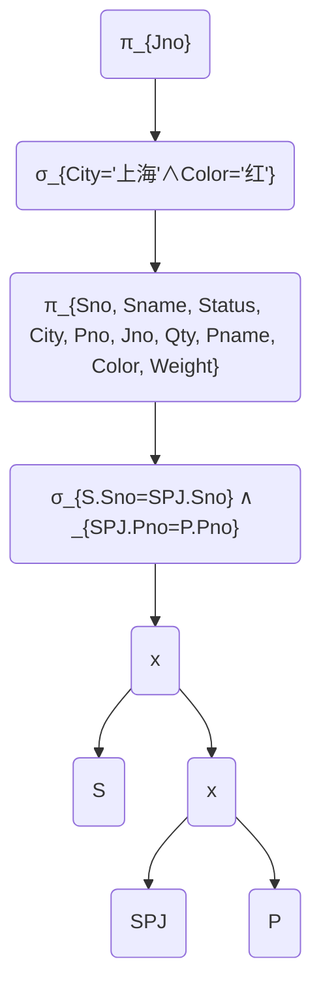
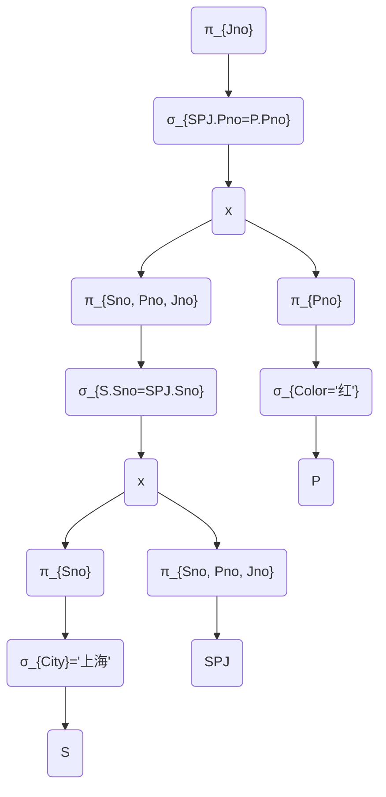

# 关系数据库概述

## 相关名词

1. 关系：在关系数据库中，实体以及实体间的联系都是用关系来表示的。类似于程序设计语言中变量的概念。
2. 关系模式：是对关系的描述。类似于程序设计语言中类型定义的概念。
3. 关系模型：是由若干个关系模式组成的集合。
4. 属性：用来描述某一个事物的特征。
5. 域：每个属性的取值范围所对应一个值的集合。
6. 候选码：若关系中的某一属性或属性组的值能唯一标识一个元组，则称该属性或属性组为候选码。
7. 主码：又称为主键，若一个关系有多个候选码，则选定其中一个为主码。
8. 主属性：包含在任何候选码中的各个属性称为主属性。
9. 非主属性：不包含在任何候选码中的属性称为非主属性。
10. 外码：如果关系模式 $R$ 中的属性或属性组非该关系的码，但它是其他关系的码，那么该属性集对关系模式 $R$ 而言是外码。
11. 全码：关系模型的所有属性组是这个关系模式的候选码，称为全码。
12. 元组/记录：行
13. 字段、数据项
14. 元数：属性的个数（列数）
15. 基数：记录的个数（行数）
16. $n$ 元关系：元数为几，就是几元关系。

:::default
例：关系模式：$\text{Student(Sno,\ Sname,\ SD, \ Sex)}$

:::

## 关系数据库模式

关系模式可以表示为：$\text{R(U,\ D,\ dom,\ F))}$

$R$ 表示关系名，$U$ 是组成该关系的属性名集合；$D$ 是属性的域；$\text{dom}$ 是属性向域的映像集合；$F$ 为属性间数据的依赖关系集合。

通常将关系模式简记为：$R(U)$ 或 $\text{R}(A_1\ ,A_2,\ A_3,…,\ A_n)$

其中，$R$ 为关系名，$A_1,A_2,A_3,…,A_n$ 为属性名或域名。

:::default
例：学生关系 $S$ 有学号 $\text{Sno}$、学生姓名 $\text{Sname}$、系名 $\text{SD}$、年龄 $\text{SA}$ 属性；课程关系  $C$  有课程号 $\text{Cno}$、课程名 $\text{Cname}$、先修课程号 $\text{PCno}$ 属性；学生选课关系 $\text{SC}$ 有学号 $Sno$、课程号 $\text{Cno}$、成绩 $\text{Grade}$ 属性。定义关系模式及主码如下（未考虑 $F$，即属性间的依赖关系）。

1. 学生关系模式 $\text{S(Sno,Sname,SD,SA)}$
2. 课程关系模式 $\text{C(Cno,Cname,PCno),Dom(PCno)=Cno}$
3. 学生选课关系模式 $\text{SC(Sno,Cno,Grade)}$
:::

## 关系的三种类型

1. 基本关系（基本表或基表）：它是实际存在的表，是实际存储数据的逻辑表示。
2. 查询表。查询结果对应的表。
3. 视图表。它是一种虚拟表，是由基本表或其他视图表导出的表。它本身是不独立存储在数据库的，数据库只存放它的定义。

## 关系的完整性约束

关系的完整性约束：是对关系的某种约束条件，用来保证用户对数据库作出修改时不会破坏数据的一致性，防止对数据的意外破坏。

1. 实体完整性：是指基本关系R的主属性不能取空值。

2. 参照完整性：

    $S($++学号++,姓名,所属院系,年龄$)$

    $D($++院系编号++,学院名称,学院地址,系主任$)$
3. 用户定义完整性：是针对某一具体的关系数据库的约束条件，反映某一具体应用所涉及到的数据必须满足的语义要求。

# 关系运算

## 基本的关系代数运算

### 并(Union)

关系 $R$ 与 $S$ 具有相同的关系模式，即 $R$ 与 $S$ 的元数相同（结构相同），关系 $R$ 与 $S$ “并”由属于 $R$ 或属于 $S$ 的元组构成的集合组成，记作 $R∪S$，其形式定义如下：
$$
R∪S=\{t|t\in R \lor t\in S\}
$$

式中 $t$ 为元组变量

### 差

关系 $R$ 与 $S$ 具有相同的关系模式，关系 $R$ 与 $S$ 的差是由属于 $R$ 但不属于 $S$ 的元组构成的集合，记作 $R-S$，其形式定义如下：
$$
R-S=\{t|t\in R\land t\notin S\}
$$

### 广义笛卡儿积

两个元数分别为 $n$ 目和 $m$ 目的关系 $R$ 和 $S$ 的广义笛卡儿积是一个 $(n+m)$ 列的元组的集合。元组的前 $n$ 列是关系 $R$ 的一个元组，后 $m$ 列是关系 $S$ 的一个元组，记作 $R×S$。

### 投影及广义投影

投影是从关系的垂直方向进行运算，在关系R中选择出若干属性列 $A$ 组成新的关系，记作 $\Pi_A(R)$，其形式定义如下：
$$
\Pi_A(R)=\{t[A]|t\in R\}
$$
广义投影运算允许在投影列表中使用算术运算，实现了对投影运算的扩充。若有关系 $R$ ，条件 $F_1,F_2,…,F_n$ 中的每一个都是涉及 $R$ 中常量和属性的算术表达式，那么广义投影运算的形式定义为：
$$
\Pi_{F_1,F_2,…,F_n}(R)
$$

### 选择

选择运算是从关系的水平方向进行运算，是从关系 $R$ 中选择满足给定条件的诸元组，记作 $σ_F(R)$，其形式定义如下：
$$
σ_F(R)=\{t|t\in R\land F(T)=\mathrm{True}\}
$$
其中，$F$ 中的运算对象是属性名（或列的序号）或常数，运算符、算术比较符（$<,\ >,\ ⩾,\ ⩽,\ ≠$）和逻辑运算符（$∧,\ ∨,\ ¬$）。

:::default
例如，$σ_{1⩾6}(R)$ 表示选取关系 $R$ 中第 $1$ 个属性值大于等于第 $6$ 个属性值的元组；

$σ_{1>'6'}(R)$表示选取关系 $R$ 中第 $1$ 个属性值大于 $6$ 的元组。

注意 $6$ 和 $'6'$ 的区别，$6$ 是指从左往右数第 $6$ 个属性，$'6'$ 是指数字 $6$（数值格式或文本格式）
:::

:::primary
例：设有关系 $R,S$ 如下图所示，请求出 ${R×S,\Pi_{A, C}(R), σ_{A>B}(R),σ_{3<4}(R×S)}$
:::

<Collapse title="答案" type="default">

</Collapse>

## 扩展的关系运算

### 交

关系 $R$ 与 $S$ 具有相同的关系模式，关系 $R$ 与 $S$ 的交由属于 $R$ 同时又属于 $S$ 的元组构成，关系 $R$ 与 $S$ 的交记作 $R\cap S$，其形式定义如下：
$$
R\cap S=\{t|t\in R\land t\in S\}
$$

### 连接

分为 $θ$ 连接、等值连接与自然连接

#### $θ$ 连接

可以由基本的关系运算笛卡儿积和选取运算导出。
$$
R\bowtie_{XθY}S=σ_{XθY}(R×S)
$$
其中，$θ$为比较运算符，如 $>,<,=,≠$，$X$ 和 $Y$ 分别为 $R$ 和 $S$ 上可以进行比较的属性组。

:::primary
例：设有关系$R$ 和 $S$ 如下图所示，求$R ⨝_{R.A<S.B}S$
:::

<Collapse title="答案" type="primary">

</Collapse>

#### 等值连接

当 $θ$ 为“$=$”时，称为等值连接，记为$R⨝_{X=Y}S$。

#### 自然连接

是一种特殊的等值连接，它要求两个关系中进行比较的分量必须是相同的属性组，并且在结果集中将重复属性列去掉。如果没有重复属性，那么自然连接就转化为笛卡儿积。

:::primary
例：设有关系 $R$ 与 $S$ 如下图所示，求$R⨝S$。
:::

<Collapse title="答案" type="primary">

</Collapse>

### 除

### 外连接

外连接运算是连接运算的扩展，可以处理缺失的信息。

#### 左外连接 $⟕$（左侧为准，右侧填充）

取出左侧关系中所有与右侧关系中任一元组都不匹配的元组，用空值 NULL 填充所有来自右侧关系的属性，构成新的元组，将其加入自然连接的结果中。

​    

#### 右外连接 $⟖$（右侧为准，左侧填充）

取出右侧关系中所有与左侧关系中任一元组都不匹配的元组，用空值 NULL 填充所有来自左侧关系的属性，构成新的元组，将其加入自然连接的结果中。

#### 全外连接

## 对关系运算的简单总结

|   关系运算    |       运算符        |       示例        |                          一句话记忆                          |         前提条件          |
| :-----------: | :-----------------: | :---------------: | :----------------------------------------------------------: | :-----------------------: |
|      并       |       $\cup$        |     $R\cup S$     |                  在 $R$ 中或者在 $S$ 中的行                  | $R$ 与 $S$ 的关系模式相同 |
|      差       |         $-$         |       $R-S$       |                  在 $R$ 中却不在 $S$ 中的行                  | $R$ 与 $S$的关系模式相同  |
|      交       |       $\cap$        |     $R\cup S$     |                  既在 $R$ 中又在$S$ 中的行                   | $R$ 与 $S$的关系模式相同  |
|   笛卡尔积    |      $\times$       |    $R\times S$    |                                                              |                           |
|     选择      |      $\sigma$       | $\sigma_{1<3}(R)$ |                       选择满足条件的行                       |                           |
|     投影      |        $\Pi$        | $\Pi_{A,B-C}(R)$  |                       选择满足条件的列                       |                           |
|      除       |         $÷$         |       $R÷S$       |                                                              |                           |
| $\theta$ 连接 | $\Join_{X\theta Y}$ | $R⨝_{X\theta Y}S$ |    先求出笛卡儿积，再做选择运算，选取满足“$XθY$”条件的行     |                           |
|   等值连接    |    $\Join_{X=Y}$    |   $R⨝_{X= Y}S$    |    先求出笛卡儿积，再做选择运算，选取满足“$X=Y$”条件的行     |                           |
|   自然连接    |       $\Join$       |    $R\Join S$     | $R$ 与 $S$ 进行等值连接时，比较的属性相同，且结果中要去掉重复属性列 | $R$ 与 $S$ 有相同的属性列 |
|   左外连接    |         $⟕$         |      $R ⟕ S$      |           在自然连接的基础上，以左侧为准，右侧补齐           |                           |
|   右外连接    |         $⟖$         |       $R⟖S$       |           在自然连接的基础上，以右侧为准，左侧补齐           |                           |
|   全外连接    |         $⟗$         |       $R⟗S$       |               将左外连接和右外连接的结果求并集               |                           |

# 元组演算、域演算与查询优化

## 元祖演算

元组关系演算是非过程化查询语言，简称元组演算。它只描述所需信息，而不给出获得该信息的 具体过程。

在元组演算中，其元组演算表达式中的变量是以元组为单位的，其一般形式为： 
$$
\{t|P(t)\}
$$
其中，$t$ 是元组变量，$P(t)$ 是元组演算公式，公式是由原子公式组成。

### 原子公式

1. $R(t)$

   $R$ 是关系名，$t$ 是元组变量，$R(t)$ 表示：$t$ 是关系 $R$ 中的一个元组。

2. $t[i]\ θ\ C$ 或 $C\ θ\ t[i]$
	$t[i]$ 表示元组变量 $t$ 的第 $i$ 个分量，$C$ 是常量，$θ$ 为算术比较运算符。

3. $t[i]\ θ\ u[j]$
	$t$ 和 $u$ 是两个元组变量。$t[i]\ θ\ u[j]$ 表示元组变量 $t$ 的第 $i$ 个分量与元组变量 $u$ 的第 $j$ 个分量之间满足 $θ$ 运算。

### 公式的定义

若一个公式的一个元组变量前有全称量词 $⩝$ 或存在量词 $∃$ 符号，则称该变量为约束变量，否则称之为自由变量。公式可递归定义如下：

1. 原子公式是公式。

2. 如果 $φ1$ 和 $φ2$ 是公式，那么，$¬φ1$，$φ1∨φ2$，$φ1∧φ2$，$φ1⇒φ2$ 也都是公式。分别表示如下命题： $¬φ1$ 表示“$φ1$ 不为真”，$φ1∨φ2$ 表示“$φ1$ 或$φ2$ 为真”，$φ1∧φ2$ 表示“$φ1$ 和 $φ2$ 都为真”；$φ1⇒φ2$表示“若 $φ1$ 为真则 $φ2$ 为真”。

3. 如果是 $φ1$ 公式，那么，$∃t(φ1)$ 是公式。$∃t(φ1)$ 表示这样一个命题： “如果有一个 $t$ 使 $φ1$ 为真，则$∃t(φ1)$ 为真，否则 $∃t(φ1)$ 为假”。

4. 如果是 $φ1$ 公式，那么，$⩝t(φ1)$ 是公式。$⩝t(φ1)$ 表示这样一个命题： “如果对所有的 $t$ 使 $φ1$ 为真，则$⩝t(φ1)$为真，否则 $⩝t(φ1)$为假”。

公式中运算符的优先顺序为：

$θ > ⩝$ 和 $∃ > ¬ > ∧$ 和 $∨ > ⇒$，加括号时，括号中的运算符优先。

:::primary
例：设有关系 $R$、$S$ 如下图所示，对如下所示的元组演算表达式，求出它们的值。

1. $R1 = \{ t | R(t) ∧ ¬S(t) \}$
2. $R2 = \{ t | S(t) ∧ t[3]>t[2] ∧ t[2]<8 \}$ 
3. $R3 = \{ t | (∃u) (R(t) ∧ S(u) ∧ t[3]<u[2]) \}$
4. $R4 = \{ t | (⩝u) (R(t) ∧ S(u) ∧ t[3]>u[1]) \}$
5. $R5 = \{ t | (∃u) (∃v) (R(u) ∧ S(v) ∧ u[2]>v[1] ∧ t[1]=u[1] ∧ t[2]=v[1] ∧ t[3]=v[3]) \}$
:::

<Collapse title="答案：" type="primary">

$R$ 表格如下：

|  A   |  B   |  C   |
| :--: | :--: | :--: |
|  1   |  2   |  3   |
|  4   |  5   |  6   |
|  7   |  8   |  9   |
|  10  |  11  |  12  |

$S$ 表格如下：

|  A   |  B   |  C   |
| :--: | :--: | :--: |
|  3   |  7   |  11  |
|  4   |  5   |  6   |
|  5   |  9   |  13  |
|  6   |  10  |  14  |

则有 $R1$：

|  A   |  B   |  C   |
| :--: | :--: | :--: |
|  1   |  2   |  3   |
|  7   |  8   |  9   |
|  10  |  11  |  12  |

$R2$：

|  A   |  B   |  C   |
| :--: | :--: | :--: |
|  3   |  7   |  11  |
|  4   |  5   |  6   |

$R3$：$∃u$ 表示：只要有一个（存在一个）$u$ 使得后面的公式成立就可以了，即 $t[3]$ 只要小于 $u[2]$ 中的其中一个就可以了，如果 $t[3]⩾$ 所有 $u[2]$，就说明不存在任何一个 $u$ 满足条件。

|  A   |  B   |  C   |
| :--: | :--: | :--: |
|  1   |  2   |  3   |
|  4   |  5   |  6   |
|  7   |  8   |  9   |

$R4$：对任意一个（所有的）$u$，都要使后面的公式成立，只要有一个 $u$ 没有满足这个条件，就不行。即：满足条件的$t[3]$ 应该大于所有的 $u[1]$。

|  A   |  B   |  C   |
| :--: | :--: | :--: |
|  7   |  8   |  9   |
|  10  |  11  |  12  |

$R5$

| R.A  | S.A  | S.C  |
| :--: | :--: | :--: |
|  4   |  3   |  11  |
|  4   |  4   |  6   |
|  7   |  3   |  11  |
|  7   |  4   |  6   |
|  7   |  5   |  13  |
|  7   |  6   |  14  |
|  10  |  3   |  11  |
|  10  |  4   |  6   |
|  10  |  5   |  13  |
|  10  |  6   |  14  |

</Collapse>

## 域演算

域关系演算简称域演算。在域演算中，表达式中的变量是表示域的变量，可将关系的属性名视为 域变量，域演算表达式的一般形式为
$$
\{t_1,…,t_k|P(t_1,…,t_k)\}
$$
其中，$t_1,…,t_k$ 是域变量，$P(t_1,…,t_k)$ 是域演算公式。

### 原子公式

1. $R(t_1,…,t_i,…,t_k)$ 

   $R$ 是 $k$ 元关系，$t_i$ 是元组变量 $t$ 的第 $i$ 个分量，$R(t_1,…,t_i,…,t_k)$表示这样一个命题： 以$t_1,…,t_i,…,t_k$为分量的元组在关系$R$。

2. $t_iθC$ 或 $Cθt_i$ 

   $t_i$ 表示元组变量 $t$ 的第 $i$ 个分量，$C$ 是常量，$θ$ 为算术比较运算符。

3. $t_iθu_j$

   $t_i$ 和 $u_j$ 是两个域变量。$t_iθ u_j$ 表示元组变量 $t$ 的第 $i$ 个分量与元组变量 $u$ 的第 $j$ 个分量之间满足 $θ$ 运算。

### 公式的定义

若一个公式的一个元组变量前有全称量词 $⩝$ 或存在量词 $∃$ 符号，则称该变量为约束变量，否 则称之为自由变量。

公式可递归定义如下： 

1. 原子公式是公式。 
2. 如果 $φ1$和 $φ2$ 是公式，那么，$¬φ1$，$φ1∨φ2$，$φ1∧φ2$，$φ1⇒φ2$ 也都是公式。
3. 如果是 $φ1$ 公式，那么，$∃t_i(φ_1)$ 是公式。$∃t_i(φ_1)$ 表示这样一个命题： “如果有一个 $t_i$ 使 $φ_1$ 为真，则 $∃t_i(φ_1)$ 为真，否则 $∃t_i(φ_1)$ 为假”。
4. 如果 $φ_1(t_1,…,t_i,…,t_k)$ 是公式，那么，$⩝t_i(φ_1)$ 是公式。$⩝t(φ_1)$ 表示这样一个命题： “如果对所有的 $t_i$ 使 $φ_1(t_1,…,t_i,…,t_k)$ 为真，则 $⩝t_i(φ_1)$ 为真，否则 $⩝t_i(φ_1)$ 为假”。

公式中运算符的优先顺序为： $θ > ⩝$ 和 $∃ > ¬ > ∧$ 和 $∨ > ⇒$，加括号时，括号中的运算符优先。

:::primary
例：设有关系 $R$、$S$ 如下图所示，对如下所示的域演算表达式，求出它们的值。

1. $R_1 = \{ t_1 t_2 t_3 | R (t_1 t_2t_3) ∧ t_1 < t_2 ∧ t_2 > t_3 \}$
2. $R_2 = \{ t_1t_2t_3 | ( R (t_1t_2t_3) ∧ t_1>4 ) ∨ ( S (t_1t_2t_3) ∧ t_2<8) \}$
3. $R_3 = \{ t_1t_2t_3 | (∃u)(∃v)(∃w) R(ut_2v) ∧ S(t_1wt_3) ∧ u⩾7 ∧ v>w \}$
:::

<Collapse title="答案：" type="primary">

$R$：
|  A   |  B   |  C   |
| :--: | :--: | :--: |
|  1   |  2   |  1   |
|  4   |  5   |  7   |
|  7   |  8   |  6   |
|  10  |  11  |  9   |
$S$：
|  A   |  B   |  C   |
| :--: | :--: | :--: |
|  1   |  2   |  3   |
|  4   |  5   |  6   |
|  7   |  8   |  8   |
|  10  |  11  |  11  |
$R_1$：
|  A   |  B   |  C   |
| :--: | :--: | :--: |
|  1   |  2   |  1   |
|  7   |  8   |  6   |
|  10  |  11  |  9   |
$R_2$：
|  A   |  B   |  C   |
| :--: | :--: | :--: |
|  7   |  8   |  6   |
|  10  |  11  |  9   |
|  1   |  2   |  3   |
|  4   |  5   |  6   |
$R_3$：
| S.A  | R.B  | S.C  |
| :--: | :--: | :--: |
|  1   |  8   |  3   |
|  4   |  8   |  6   |
|  1   |  11  |  3   |
|  4   |  11  |  6   |
|  7   |  11  |  9   |

</Collapse>

## 查询优化

查询优化是指为查询选择最有效的查询计划的过程。一个查询可能会有多种实现方法，关键是如 何找出一个与之等价的且操作时间又少的表达式，以节省时间、空间，提高查询效率。

在关系代数运算中，笛卡儿积、连接运算是最耗费时间和空间的。 

优化的准则：

1. 提早执行选取运算。对于有选择运算的表达式，应优化成尽可能先执行选择运算的等价表达式， 以得到较小的中间结果，减少运算量和从外存读块的次数。 
2. 合并乘积与其后的选择运算为连接运算。
3. 将投影运算与其后的其他运算同时进行，以避免重复扫描关系。
4. 将投影运算和其前后的二目运算结合起来，使得没有必要为去掉某些字段再扫描一遍关系。
5. 在执行连接前对关系适当地预处理，就能快速地找到要连接的元组。方法有两种：索引连接法、 排序合并连接法。 
6. 存储公共子表达式。对于有公共子表达式的结果应存于外存（中间结果），这样，当从外存读 出它的时间比计算的时间少时，就可节约操作时间。

:::primary
例：供应商数据库中有：供应商 $S$、零件 $P$ 、项目 $J$ 、供应 $SPJ$ 四个基本表（关系），其关系模式如下所示：

$\text{S (Sno, Sname, Status, City)}$ 供应商编号，供应商名称，供应商城市 

$\text{P (Pno, Pname, Color, Weight)}$ 零件号，零件名称，颜色，重量

$\text{J (Jno, Jname, City)}$工程号，项目名称，所在城市 

$\text{SPJ (Sno, Pno, Jno, Qty)}$ 供应商编号，零件编号，工程号，数量

若用户要求查询使用“上海”供应商生产的“红色”零件的工程号，请解答如下问题： 

1. 试写出该查询的关系代数表达式；
2. 试写出查询优化的关系代数表达式。
3. 画出该查询初始的关系代数表达式的语法树。
4. 使用优化算法，对语法树进行优化，并画出优化后的语法树。
:::

<Collapse title="答案" type="primary">

$\pi_{Jno}(σ_{City='上海'∧Color='红'}(S⨝SPJ⨝P) )$

$\pi_{Jno}(\pi_{Sno}(\sigma _{city = '上海'(S)}) \Join \pi_{Sno, Pno, Jno} (SPJ)\Join \pi_{Pno} ( \sigma_{Color} = '红' (P)))$

</Collapse>

# 关系数据库设计基础知识

## 函数依赖

定义：设 $R(U)$ 是属性集 $U$ 上的关系模式，$X$、$Y$ 是 $U$ 的子集。**若对 $R(U)$ 的任何一个可能的关系 $r$ **，$r$ 中不可能存在两个元组在 $X$ 上的属性值相等，而在 $Y$ 上的属性值不等， 则称 $X$ 函数决定 $Y$ 或 $Y$ 函数依赖于 $X$ ，记作：$X→Y$

- 如果 $X→Y$，那么对于任意两个相同的 $X$，所对应的 $Y$ 是一定相同的。 

- 如果 $X→Y$，但 $Y⊈X$，则称 $X→Y$ 是非平凡的函数依赖。一般情况下总是讨论非平凡 的函数依赖。

- 如果 $X→Y$，但 $Y⊆X$，则称 $X→Y$ 是平凡的函数依赖。 

函数依赖的定义要求关系模式 $R$ 的任何可能的 $r$ 都满足上述条件。因此不能仅考察关系模式 $R$ 在某一时刻的关系 $r$，就断定某函数依赖成立。

函数依赖是语义范畴的概念，我们只能根据语义来确定函数依赖。

## 完全函数依赖与部分函数依赖

定义：在 $R(U)$ 中，如果 $X→Y$，并且对于 $X$ 的任何一个真子集$X'$，都有 $X'$ 不能决定 $Y$  ，则称 $Y$ 对 $X$ 完全函数依赖，记作：$X→Y$。如果 $X→Y$，但 $Y$ 不完全函数依赖于 $X$ ，则称 $Y$ 对 $X$ 部分函数依赖，记作：$X→Y$。部分函数依赖也称局部函数依赖

:::info
例：选课关系 SC1(++学号,课程号++,成绩)，F=\{(学号,课程号)→ 成绩\}

则有 (学号,课程号)→ 成绩，学号⇸成绩,课程号⇸成绩。

选课关系SC2(++学号,课程号++,学生姓名,课程名称,成绩)，

F=\{(学号,课程号)→ 成绩,(学号,课程号)→ 课程名称,(学号,课程号)→ 学生姓名,学号→学生 姓名,课程号 → 课程名称\}
:::

### 传递函数依赖

定义：在 $R(U,F)$ 中，如果 $X→Y$，$Y→Z$，$Y⊈X$，$Y⇸X$，则称 $Z$ 对 $X$ 传递依赖。 

:::primary
例：供应商$\text{(Sno,Sname,Status,City,Pno,Qty)}$​，及函数依赖集如下，判断该关系是否存在传递函数依赖和部分函数依赖。
:::

<Collapse title="答案" type="primary">

$\text{F=\{Sno→Sname, Sno→Status, Status→City,(Sno,Pno)→Qty\}}$

</Collapse>

## 码

### 候选码和主码

设 $K$ 为 $R(U,F)$ 中的属性的组合，若 $K→U$，且对于 $K$ 的任何一个真子集 $K'$，都有 $K'$ 不 能决定 $U$ ，则 $K$ 为 $R$ 的候选码，若有多个候选码，则选一个作为主码。

- 候选码通常也可以称为候选关键字，主码通常也可以称为主关键字或主键。 
- 包含在任何一个候选码中的属性叫做主属性，否则叫做非主属性。 

:::info
例：选课关系$\text{SC1(Sno,Cno,Sname,Cname,G)}$ ，选课关系$\text{SC2(Sno,Cno,Sname,Cname)}$
:::
### 外码

若 $R(U)$ 中的属性或属性组 $X$ 非 $R$ 的码，但 $X$ 是另一个关系的码，则称 $X$ 是 $R$ 的 外码（Foreign Key）或称外键。 

例：学生（学号，姓名，++班主任++，所属学院），教师（++职工号++，姓名），学院（++编号++，名称）

### 多值依赖

定义：若关系模式 $R(U)$ 中，$X$，$Y$，$Z$ 是 $U$ 的子集，并且 $Z=U-X-Y$。当且仅当对 $R(U)$ 的任何一个关系 $r$，给定一对 $(x,z)$ 值，有一组 $Y$ 的值，这组值仅仅决定于 $x$ 值而与 $z$ 值无关，则称“$Y$ 多值依赖于 $X$ ”或“$X$ 多值决定 $Y$ ”成立。记为： $X→→Y$

:::info
例：参考书目（课程，教师，参考书） ，课程 $→→$ 参考书

:::

如果 $Z=∅$，为平凡的多值依赖； 

如果 $Z≠∅$，则为非平凡的多值依赖。

多值依赖具有如下 6 条性质：

1. 多值依赖具有对称性。即若 $X→→Y$，则 $X→→Z$，其中$Z=U-X-Y$。 
2. 多值依赖的传递性。即若 $X→→Y,Y→→Z$,则 $X→→Z-Y$。 
3. 函数依赖可以看成是多值依赖的特殊情况。 
4. 若 $X→→Y,X→→Z$，则 $X→→YZ$。 
5. 若 $X→→Y,X→→Z$，则 $X→→Y ⋂Z$。 
6. 若 $X→→Y,X→→Z$，则 $X→→Z-Y$。
