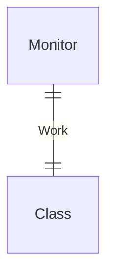
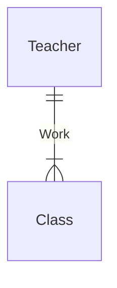
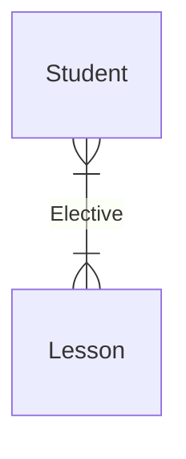

# 数据库系统的三级模式结构

## 数据库的三级模式结构

## 数据抽象

1. 物理层：描述数据在存储器中是如何存储的。

2. 逻辑层：描述数据库中存储什么数据以及这些数据间存在什么关系。

3. 视图层：描述整个数据库的某个部分。

## 三级模式

1. 外模式：也称用户模式或子模式，是用户与数据库系统的接口，是用户用到的那部分数据的描述。

2. 概念模式：也称模式，是数据库中全部数据的逻辑结构和特征的描述，只涉及型的描述，不涉及具体的值。

3. 内模式：也称存储模式，是数据物理结构和存储方式的描述，定义所有的内部记录类型、索引和文件的组织方式，以及数据控制方面的细节。

## 两级映象

模式/内模式映像、外模式/模式映像

## 数据的独立性

1. 数据的物理独立性：它是指当数据库的内模式发生改变时，数据的逻辑结构不变。
2. 数据的逻辑独立性：它是指用户的应用程序与数据库的逻辑结构是相互独立的，数据的逻辑结构发生变化后，用户程序也可以不修改，但是，为了程序能够正确执行，需要修改外模式/模式之间的映像。

# 数据模型

## 什么是数据模型？

就是对现实世界数据特征的抽象。 常用的数据模型有概念数据模型和基本数据模型。

### 概念数据模型

也称为信息模型，是按用户的观点对数据和信息建模，是现实世界到信息世界的第一层抽象，强调其语义表达功能，易于用户理解，是用户和数据库设计人员交流的语言，主要用于数据库设计。这类模型中最著名的是实体联系模型，简称 E-R 模型。

#### 基本数据模型

是按照计算机系统的观点对数据建模，是现实世界数据特征的抽象，用于 DBMS 的实现。目前常用的有：层次模型，网状模型、关系模型和面向对象数据模型。

## 数据模型的三要素

1. 数据结构：是所研究的对象类型的集合，是对系统静态特征的描述。 
2. 数据操作：对数据库中各种对象（型）的实例（值）允许执行的操作的集合，包括操作及操作规则。
3. 数据的约束条件：是一组完整性规则的集合。

# E-R模型

实体-联系（E-R）方法是概念模型中常用的方法，该方法直接从现实世界中抽象出实体和实体间的联系，然后用非常直观的 E-R 图来表示数据模型。

## 实体

实体是现实世界中可以区别于其他对象的“事物”或“物体”，每个实体由一组特性（属性）来表示，其中的某一部分属性可以唯一标识某个实体，如职工号。

## 联系

### 两个不同实体之间的联系

一对一（1:1）：一个班长只能在一个班级任职，一个班级只能有一个班长。

一对多（1:\*）：一个教师可以教授多门课程，一门课程只能被一位教师讲授。

多对多（\*:\*）：一个学生可以选修多门课程，一门课程可以由多位学生选修。

### 两个以上不同实体集之间的联系

1. 1:1:1：

2. 1:1:\*：

3. 1:\*:\*：一个特护病房有多个病人和多个医生，一个医生只负责一个病房，一个病人只属于一个病房。

4. \*:\*:\*：一个供应商可以为多个项目供应多种零件，每个项目可用多个供应商供应的零件，每种零件可由不同的供应商供应。

### 同一实体集内的二元联系

同一实体集内的两个实体之间相互存在着一定的关系。

## 属性

1. 简单属性和复合属性：简单属性是原子的、不可再分的，复合属性可以细分为更小的部分。如通信地址可以进一步细分为省、市、街道、邮编等。

2. 单值属性和多值属性：指一个属性有单个值或多个值。如职工的亲属姓名。

3. NULL 属性：当实体在某个属性上没有值或属性值未知时，使用 NULL 值。表示无意义或不知道。

4. 派生属性：可以从其他属性得来。如参加工作时间和工作年限，身份证号和年龄等。

## 扩充的E-R模型

### 弱实体

一个实体的存在必须以另一个实体为前提。

### 特殊化

某些实体一方面具有一些共性，另一方面还具有各自的特殊性。这样，一个实体集可以按照某些特征区分为几个子实体。

