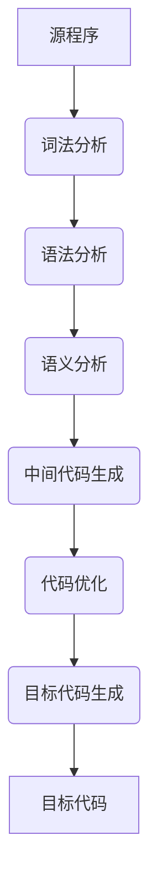

# 程序语言概述

## 低级语言和高级语言

低级语言：机器语言和汇编语言。是一种面向机器的语言，其格式取决于计算机的机器指令。难以理解，程序可读性差，程序设计效率低。

高级语言：面向各类应用的程序语言。如 Java、C、C++、Python、PHP、JavaScript 等等。与人们使用的语言较为接近，便于理解，提高了程序设计的效率。

## 汇编、解释、编译

高级程序语言必须进行翻译才能为计算机硬件所理解，常用的翻译方式有汇编、解释和编译。

- 用汇编语言编写的：需要汇编程序翻译成目标程序，然后执行目标程序。
- 用高级语言编写的：需要解释程序或编译程序进行翻译，然后再运行。

## 编绎程序和解释程序：

解释程序（解释器）：要么直接解释执行源程序，要么将源程序翻译成某种中间代码后再加以执行。它按源程序中语句的执行顺序，逐条翻译并立即执行相关功能。

编译程序（编译器）：将源程序翻译成目标程序（目标代码），然后再在计算机上运行目标程序。一般分为两个阶段：

- 编译阶段：把源程序翻译成目标程序。
- 运行阶段：执行目标程序。

## 编绎和解释的区别

- 编译方式下，机器上运行的是与源程序等价的目标程序，源程序和编译程序都不再参与目标程序的执行过程。
- 解释方式下，解释程序和源程序（或其某种等价表示）要参与到程序的运行过程中，运行程序的控制权在解释程序。

简单来说，在解释方式下，翻译源程序时不生成独立的目标程序，而编译器则将源程序翻译成独立保存的目标程序。

## 编绎和解释的比较：

- 编译比解释方式可能取得更高的效率。
- 解释方式比编译方式更灵活。
- 解释方式可移植性好。

# 程序语言的数据成分

1. 常量和变量：按照程序运行时数据的值能否改变，将程序中的数据分为常量和变量。

2. 全局变量和局部变量：按数据的作用域范围，可将其分为全局变量和局部变量。系统为全局变量分配的存储空间在程序运行的过程中一般是不改变的，而为局部变量分配的存储单元是可以动态改变的。

3. 数据类型：

	- 基本类型：整型、字符型、实型和布尔类型。

	- 特殊类型：空类型。

	- 用户定义类型：枚举类型。

	- 构造类型：数组、结构、联合。

	- 指针类型：`type *`

	- 抽象数据类型：类类型。


# 程序语言的控制成分

1. 顺序结构：计算过程从所描述的第一个操作开始，按顺序依次执行后续的操作，直到序列的最后一个操作。
2. 选择结构：选择结构提供了在两种或多种分支中选择其中一个的逻辑。
3. 循环结构：循环结构描述了重复计算的过程，通常由三部分组成：初始化、循环体和循环条件

# 编译过程

编译程序的作用是把某种高级语言书写的源程序翻译成与之等价的目标程序，其工作过程一般可以分为6个阶段：



## 词法分析

任务：对源程序从前到后（从左到右）逐个字符地扫描，从中识别出一个个“单词”符号。“单词”符号是程序设计语言的基本语法单位，如关键字（保留字）、标识符、常数、运算符和标点符号、左右括号等。

## 语法分析

任务：根据语言的语法规则，在词法分析的基础上，分析单词串是否构成短语和句子，即是否为合法的表达式、语句和程序等基本语言结构，同时检查和处理程序中的语法错误。

如果源程序没有语法错误，语法分析后就能正确地构造出其语法树。

## 语义分析

任务：分析各语法结构的含义，检查源程序是否包含静态语义错误，并收集类型信息供后面的代码生成阶段使用。

语义分析的一个主要工作是进行类型分析和检查。一个数据类型一般包含两个方面的内容：类型的载体及其上的运算。例如：整除取余运算符只能对整型数据进行运算，如果运算对象为浮点数，则认为是一种类型不匹配的错误。

## 中间代码生成

任务：根据语义分析的输出生成中间代码。

常用的中间代码有：后缀式（逆波兰式）、四元式（三地址码）、树形表示。

## 代码优化

由于编译器将源程序翻译成中间代码的工作是机械的、按固定模式进行的，因此，生成的中间代码往往在时间和空间方面的效率较差。当需要生成高效的目标代码时，就必须进行优化。

优化过程可以在中间代码生成阶段进行，也可以在目标代码生成阶段进行。

## 目标代码生成

目标代码生成是编译器工作的最后一个阶段。

任务：把中间代码变换成特定机器上的绝对指令代码、可重定位的指令代码和汇编指令代码。

这个阶段的工作与具体的机器密切相关。

## 符号表管理

符号表的作用是记录源程序中各种符号的必要信息，以辅助语义的正确性检查和代码生成，在编译过程中需要对符号表进行快速有效地查找、插入、修改和删除等操作。

## 出错处理

源程序中不可避免地会有一些错误，大致分为静态错误和动态错误。

1. 动态错误发生在程序运行时，如：变量取零时作除数、引用数组下标错误等。
2. 静态错误是指编译阶段发现的程序错误，可分为语法错误和静态语义错误。
    1. 语法错误：单词拼写错误、标点符号错、表达式中缺少操作数、括号不匹配等有关语言结构上的错误。
    2. 静态语义错误：语义分析时发现的运算符和运算对象类型不合法等错误。

# 中缀、前缀与后缀表达式

中缀表达式：即我们通常所使用的表达式。如 $(a+b)*c-d$

前缀表达式（波兰式）：将运算符写在前面，操作数写在后面，且不使用括号。$-*+abcd$

后缀表达式（逆波兰式）：将运算符写在后面，操作数写在前面，且不使用括号。$ab+c*d$

三种表达式之间的转换：

例：$(a+b)*c-d$

1. 中缀表达式转前缀表达式：
	1. 按计算顺序全部加上括号：$(((a+b)*c)-d)$
	2. 把每一对括号内的运算符移到括号前面： $-(*(+(ab)c)d)$
	3. 把所有括号去掉：$-*+abcd$
2. 中缀表达式转后缀表达式：
	1. 按计算顺序全部加上括号： $(((a+b)*c)-d)$
	2. 把每一对括号内的运算符移到括号后面： $(((ab)+c)*d)-$
	3. 把所有括号去掉：$ab+c*d$

# 传值调用和引用调用

函数调用时基本的参数传递方式有两种：传值调用和引用调用。 

1. 传值调用：信息传递是单向的，只能将实参的值传递给形参，而形参不能再将值传递给实参。 实参可以是常量（表达式），也可以是变量（数组元素）。

```c
int sum (int x, int y) {
    int z;
    z = x + y;
    return z;
}
```

函数调用时：`sum(2, 3);`

2. 引用调用（传地址调用）： 在这种方式下，可以认为形参名实际上是实参的别名，被调函数中对形参的访问和修改实际上就是对实参的访问和修改。因此客观上可以 实现双向传递。因此只能是变量（数组元素），而不能是常量（表达式）。

```c
void swap (int &x, int &y) {
    int temp;
    temp = x;
    x = y;
    y = temp; 
}
```

函数调用时：`swap(a, b);`

