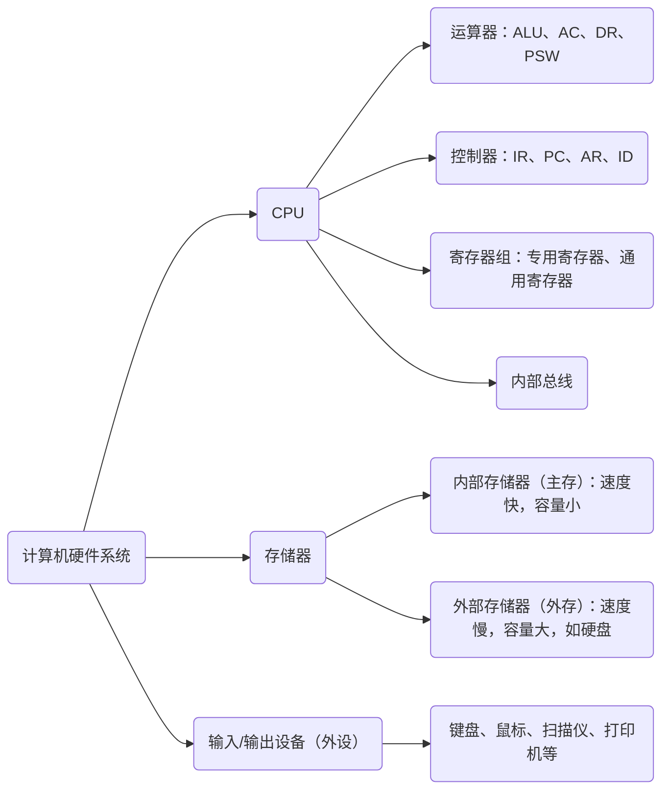
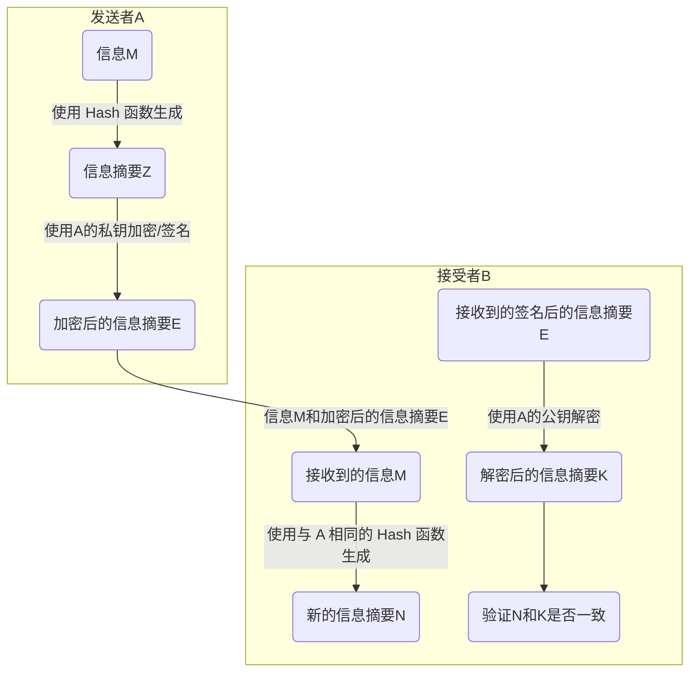
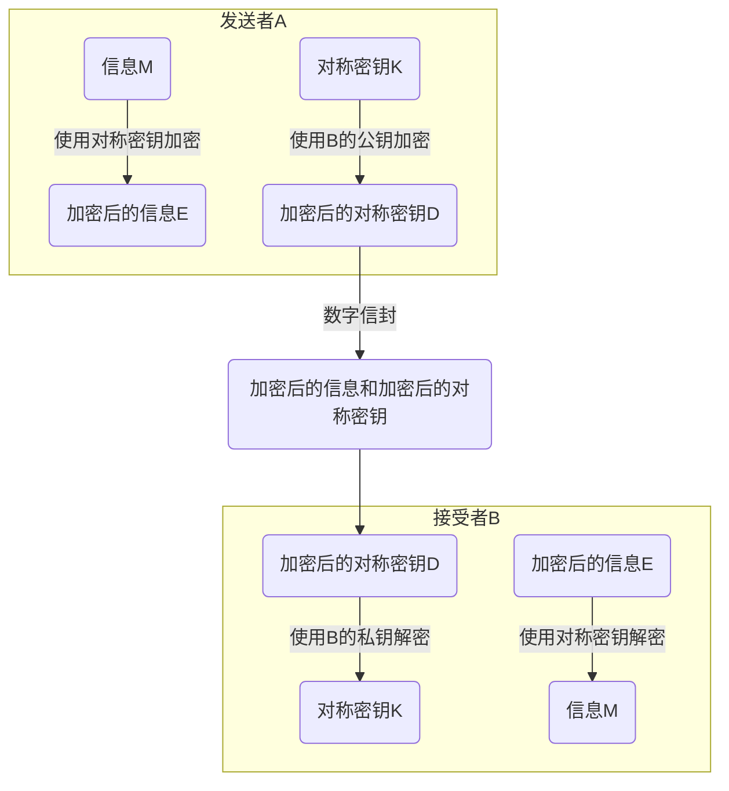

# 计算机硬件基础知识

## 计算机硬件系统的组成



## CPU的组成

### 运算器

- 功能：
    1. 执行所有的算术运算。如加、减、乘、除等基本运算及附加运算。
    2. 执行所有的逻辑运算并进行逻辑测试。如与、非、或、零值测试或两个值的比较等。
- 组成：
	1. 算术逻辑单元(ALU)：负责处理数据，实现对数据的算术运算和逻辑运算。
	2. 累加寄存器(AC)：也称累加器，当算术逻辑单元ALU执行运算时，为其提供一个工作区。
	3. 数据缓冲寄存器(DR)：对内存进行读写操作时，用DR暂时存放由内存读写的一条指令或一个数据字。作为CPU和内存、外设之间在操作速度上的缓冲，以及数据传送的中转站。
	4. 状态条件寄存器(PSW)：保存根据算术指令和逻辑指令运行或测试的结果建立的各种条件码的内容，主要分为状态标志和控制标志。如运算结果进位标志(C)、运算结果溢出标志(V)、运算结果为0标志(Z)、运算结果为负标志(N)、中断标志(I)、方向标志(D)等。

### 控制器

功能：决定了计算机运行过程的自动化。它不仅要保证程序的正确执行，而且要能够处理异常事件。

包括：指令控制逻辑、时序控制逻辑、总线控制逻辑和中断控制逻辑等几个部分。

控制器在工作过程中主要使用以下部件：

1. 指令寄存器(IR)：用来暂时存放一条指令，由指令译码器根据指令寄存器中的内容产生各种微
操作指令，控制其它部分协调工作。
2. 程序计数器(PC)：存放的是将要执行的下一条指令的地址。
3. 地址寄存器(AR)：保存当前CPU所访问的内存单元的地址。由于内存和CPU存在操作速度上的差
异，所以需要使用AR保存地址信息，直到内存读/写操作完成为止。
4. 指令译码器(ID)：对指令中的操作码字段进行分析解释，识别该指令规定的操作，然后向操作控制器发出具体的控制信号。

指令：是对机器进行程序控制的最小单位。

一条指令通常包括两个部份：操作码和操作数

操作码指出是什么操作，由指令译码器（ID）来识别。

操作数直接指出操作数本身或者指出操作数所在的地址。

寄存器组：

1. 专用寄存器：运算器和控制器中的寄存器是专用寄存器，其作用是固定的。
2. 通用寄存器：用途广泛并可由程序员规定其用途，其数目因处理器不同而不同。

## 进制转换

1. 进制的缩写：
    二进制是 Binary，简写为 B。八进制是 Octal，简写为O。十进制为 Decimal，简写为 D。十六进制为 Hexadecimal，简写为 H。
    
2. 二/八/十六进制转为十进制（按权展开）：

    二进制  $10100.01(B)=1×2^4+0×2^3+1×2^2+0×2^1+0×2^0+0×2^{-1}+1×2^{-2}$

	八进制  $256.3(O)=2×8^2+5×8^1+6×8^0+3×8^{-1}$

	十六进制  $6F8A(H)=6×16^3+15×16^2+8×16^1+10×16^0$

3. 十进制转为二/八/十六进制（整除取余法）：

    十进制 100 转为二进制：$1100100(B)$

    十进制 100 转为八进制：$144(O)$

    十进制 100 转为十六进制：$64(H)$

4. 八/十六进制转为二进制：

    八进制 $357(O)$ 转为二进制：011101111

    $3\rightarrow 011\ ,5\rightarrow101\,7\rightarrow111$

    十六进制 $A6F(H)$ 转为二进制：101001101111
    $A\rightarrow 1010\ 6\rightarrow 0110\ F\rightarrow 1111$

## 存储器与总线

总线的分类：

- 数据总线(DB)：用来传送数据信息，是双向的。DB 的宽度决定了 CPU 和计算机其他设备之间每次交换数据的位数。
- 地址总线(AB)：用于传送 CPU 发出的地址信息，是单向的。地址总线的宽度决定了 CPU 的最大寻址能力。
- 控制总线(CB)：用来传送控制信号、时序信号和状态信息等。CB 中的每一条线的信息传送方向是单方向且确定的，但 CB 作为一个整体则是双向的。

## 输入输出技术

程序控制方式：

1. 无条件传送：外设总是准备好的，无条件，随时接收和提供数据。

2. 程序查询方式：CPU 利用程序来查询外设的状态，准备好了再传数据。

3. 中断方式：CPU 不等待，也不执行程序去查询外设的状态，而是由外设在准备好以后，向 CPU 发出中断请求。

    以上三种方式都需要 CPU 的参与。

4. DMA 方式：数据的传输是在主存和外设之间直接进行，不需要 CPU 的干预，实际操作是由 DMA 硬件直接执行完成的。
   
5. 通道方式和外围处理机方式：更进一步减轻了 CPU 对 I/O 操作的控制，更进一步提高了 CPU 的工作效率，但是是以增加更多硬件为代价的。

# 计算机体系结构与存储系统

## 计算机体系结构分类

1. 按处理机的数量进行分类：

- 单处理系统
- 并行处理与多处理系统
- 分布式处理系统

2. 微观上按并行程度分类：

- Flynn 分类法
- 冯泽云分类法
- Handler 分类法等等

CISC 和 RISC

## 流水线技术

流水线周期：**各子任务中执行时间最长的（最慢的）子任务的执行时间**。

流水线执行完 n 条指令所需要的时间：

$T_n=$ 执行一条指令所需时间 $+(n-1)*$ 流水线周期

吞吐率：是指单位时间里流水线处理机流出的结果数。对指令而言，就是单位时间里执行的指令数。

吞吐率：$p=\dfrac{1}{max(Δt_1，Δt_2，…Δt_m)}$，即最长子过程所用时间的倒数。

## 存储系统


1. 存储器的分类

- 按存储器所处的位置：可分为内存和外存。
- 按构成存储器的材料：可分为磁存储器、半导体存储器和光存储器。
- 按存储器的工作方式：可分为读写存储器和只读存储器。
- 按访问方式：可分为按地址访问的存储器和按内容访问的存储器。
- 按寻址方式：可分为随机存储器、顺序存储器和直接存储器。

2. 随机访问存储器：

- 静态随机访问存储器（SRAM）
- 动态随机访问存储器（DRAM）

3. 高速缓存

- Cache 是介于 CPU 与主存之间的一级存储器，其容量较小，但速度较快，一般比主存快 5～10 倍。

- 它的主要作用是：调和 CPU 的速度与内存存取速度之间的差异，从而提升系统性能。

- 它使用的是程序的局部性原理，其内容是主存局部域的副本。

- 当CPU需要读取数据时，首先判断要访问的信息是否在 Cache 中，如果在即为命中，如果不在，就要按替换算法把主存中的一块信息调入 Cache 中。

- 替换算法有：随机替换算法、先进先出替换算法、近期最少使用替换算法、优化替换算法等。

- CPU 工作时给出的是主存的地址，要从 Cache 存储器中读写信息，就需要将主存地址转换成 Cache 存储器的地址，这种地址的转换叫作地址映像。

- 地址映像

    1. 直接映像：主存的块与 Cache 块的对应关系是固定的，主存中的块只能存放在 Cache 存储器的相同块号中。
        优点：地址变换简单，访问速度快。
        缺点：块冲突率高，Cache 空间得不到充分利用。
        主存地址：主存区号 -> 区内块号 -> 块内地址

        
        
        
        例：主存容量为 1MB，高速缓存容量为 16KB，块的大小为 512B。
        
    2. 全相联映像：主存与 Cache 存储器均分成容量相同的块。允许主存的任一块可以调入 Cache 存储器的任何一个块的空间中。
        优点：灵活，块冲突率低，只有在 Cache 中的块全部装满后才会出现冲突，Cache 利用率高。
        缺点：无法从主存块号中直接获得所对应 Cache 的块号，变换比较复杂，地址变换速度慢，成本高。
        主存地址：主存块号 -> 块内地址
    
        

	3. 组相联映像：是前两种方式的折衷。
	
	    将 Cache 中的块再分成组。组采用直接映像方式而块采用全相联映像方式。主存的任何区的 0 组只能存到 Cache 的 0 组中，1 组只能存放到 1 组中，依此类推。而组内的块可以存入Cache中相同组的任一块中。
	    
		公式：
	    
		主存地址位数 = 区号 + 组号 + 主存块号 + 块内地址
	    Cache 地址位数 = 组号 + 组内块号 + 块内地址
	
	    

		1. Cache 的性能分析：
		    设 $H_c$ 为 Cache 的命中率，$t_c$ 为 Cache 的存取时间，$t_m$ 为主存的访问时间，则 Cache 存储器的等效加权平均访问时间 $t_a$ 为：

			$$t_a=H_ct_c+(1-H_c)t_m$$
		
		
		2. **虚拟存储器**实际上是一种逻辑存储器。
		
		3. **相联存储器**是一种按内容访问的存储器。

# 安全性、可靠性与系统性能评测基础知识

## 对称加密技术

对称加密技术：文件加密和解密使用相同的密钥，或者虽然不同，也可以从其中一个很容易地推导出另一个。

$$
1101100010(明文)\Rightarrow 1000110111(密文)\Rightarrow 1101100010(明文)
$$

代表算法：

1. DES：主要采用替换和移位的方法加密。它用 56 位密钥对64位二进制数据块进行加密。
2. 3DES：用两个 56 位的密钥。
3. RC-5
4. IDEA：类似于 DES，其密钥长度为 128 位。
5. AES：基于排列和置换运算。

## 非对称加密技术

非对称加密技术：同样使用两个密钥：加密密钥和解密密钥，一个是公开的，一个是非公开的私有密钥。他们是一对，只有使用对应的密钥才能解密。

非对称加密有两个不同的体制：加密模型和认证模型。

1. 加密模型

    ```mermaid
    graph LR
    	A1(明文)-->B1(A加密)
    	A2(B的公钥)-->B1
    	B1--密文-->C1("B解密")
    	B2("B的私钥")-->C1-->D1(明文)
    ```

    A为发送者，B为接收者。

2. 认证模型：

    ```mermaid
    graph LR
    	A1(明文)-->B1(A加密)
    	A2(A的私钥)-->B1
    	B1--密文-->C1("B解密")
    	B2(A的公钥)-->C1-->D1(明文)
    ```

    非对称加密算法的保密性较好，它消除了最终用户频繁交换密钥的需要，但加密和解密花费时间长、速度慢，不适合于对文件加密，而只适用于对少量数据加密。

    代表算法：RSA，基于大素数分解的困难性。

## 信息摘要

- Hash 函数：输入一个长度不固定的字符串，返回一串固定长度的字符串，又称 Hash 值。
- 单向 Hash 函数用于产生信息摘要。
- 对于特定的文件而言，信息摘要是唯一的。
- 在某一特定的时间内，无法查找经 Hash 操作后生成特定 Hash 值的原报文，也无法查找两个经 Hash 操作后生成相同 Hash 值的不同报文。
- 在数字签名中，可以解决验证签名和用户身份验证、不可抵赖性的问题。
- MD2、MD4 和 MD5 是被广泛使用的 Hash 函数，它们产生一种 128 位的信息摘要。

## 数字签名



可以确认信息发送者的身份和信息是否被修改过。但不能保证
发送信息的保密性。

## 数字加密



可以保证发送信息的保密性，但是不能确认发送者的身份。

## 数字签名和数字加密的区别和联系

- 数字签名使用的是发送方的密钥对，任何拥有发送方公开密钥的人都可以验证数字签名的正确性。数字加密使用的是接收方的密钥对，是多对一的关系，任何知道接收方公开密钥的人都可以向接收方发送数据，但只有唯一拥有接收方私有密钥的人才能对信息解密。
- 数字签名只采用了非对称加密算法，它能保证发送信息的完整性、身份认证和不可否认性，但不能保证发送信息的保密性。
- 数字加密采用了对称密钥算法和非对称密钥算法相结合的方法，它能保证发送信息的保密性。

## 计算机可靠性

1. 计算机系统的可靠性：是指从它开始运行 $(t=0)$ 到某时刻t这段时间内能正常运行的概率，用 $R(t)$ 表示。

2. 计算机系统的失效率：是指单位时间内失效的元件数与元件总数的比例，用 $λ$ 表示。

3. 平均无故障时间 (MTBF)：两次故障之间能正常工作的时间的平均值称为

    平均无故障时间 $MTBF=\dfrac{1}{λ}$

4. 计算机系统的可维修性：一般平均修复时间 (MTRF) 表示，指从故障发生到机器修复平均所需的时间。
5. 计算机系统的可用性：指计算机的使用效率，它以系统在执行任务的任意时刻能正常工作的概率A表示。
    $A=\dfrac{MTBF}{MTBF+MTRF}$

串联系统的可靠性：

$$
R=R_1×R_2×R_3×…R_N
$$

并联系统的可靠性：

$$
R=1-(1-R_1)(1-R_2)(1-R_3)…(1-R_N)
$$

# 逻辑运算

- 逻辑与（又称逻辑乘，类似于且，AND）：两个操作数同时为真则为真，否则哪怕有一个操作数为 假，则为假。 
- 逻辑或（又称逻辑加，类似于或，OR）：两个操作数只要其中一个为真即为真。 
- 逻辑异或：（相异为真，相同为假） 
- 逻辑非（NOT，类似于取反，!=）：操作数为真，则结果为假；操作数为假，则结果为真。

| 操作数1 | 操作数2 | 逻辑与 （and） | 逻辑或（or） |逻辑异或|
| ------- | ------- | ---------------- | -------- | ----- |
| 1（TRUE） | 1（TRUE） | 1 | 1 | 0 |
| 1（TRUE） | 0（FALSE） | 0 | 1 | 1 |
| 0（FALSE） | 1（TRUE） | 0 | 1 | 1 |
| 0（FALSE） | 0（FALSE） | 0 | 0 | 0 |

